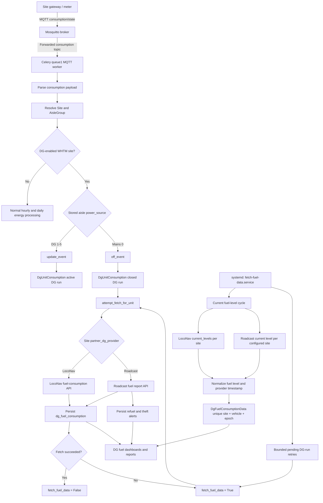
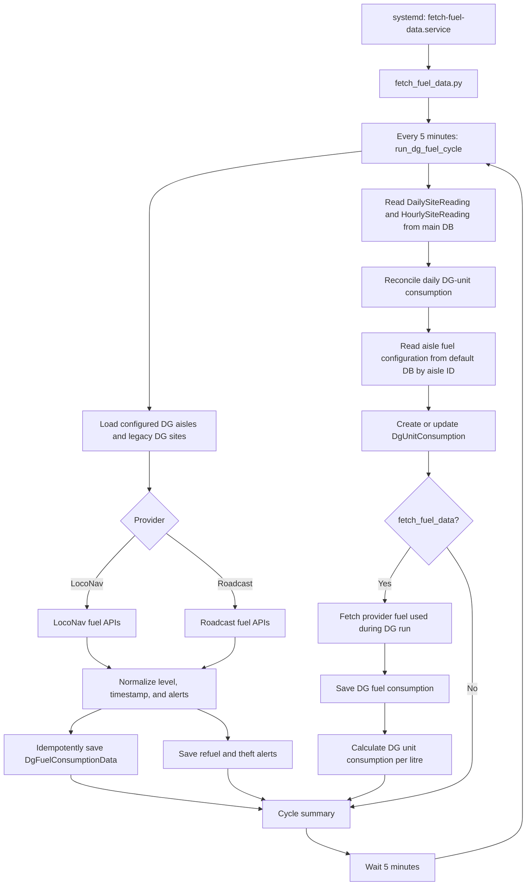

# DG Fuel Architecture

## Overview

The DG fuel subsystem has two related flows:

1. MQTT DG-session processing records generator runtime and fetches consumed fuel after a run closes.
2. The standalone `fetch_fuel_data.py` service polls provider tank levels, reconciles daily DG-unit usage, fetches historical fuel consumption, and records provider events.

`LoadData/state` messages are not part of either DG fuel flow. They are load telemetry only.



## MQTT DG Session Flow

1. The gateway publishes an MQTT `consumption/state` message.
2. Mosquitto forwards the message to the `server_paho_client_1` subscriber.
3. The Celery queue1 worker parses `Unit_consumption`, `Message_time`, and `AisleGrp_id`.
4. The worker resolves the site and aisle group.
5. For DG-enabled WHTM sites:
   - `power_source` from `1` to `5` calls `update_event` to create or update the active `DgUnitConsumption` run.
   - `power_source` of `0` calls `off_event` to close the active run.
6. When a run closes, `attempt_fetch_for_unit` requests total fuel used during the run from the configured provider.
7. A successful fetch stores `dg_fuel_consumption`; a failed fetch sets `fetch_fuel_data=True` for later retry.
8. Roadcast report results may also create normalized `refuel` and `theft` alert rows.

## Standalone Fuel Poller Flow

`main()` calls `run_once()` repeatedly. `run_once()` currently invokes
`run_dg_fuel_cycle()` and then sleeps for `DG_FUEL_POLL_INTERVAL_SECONDS`.
The default interval is 300 seconds.

For each `Site.dg_fuel_system_installed=True`, the detailed cycle performs:

1. Fetch the latest tank level from the configured provider.
2. Persist a current, valid provider sample as a fuel-level row.
3. Fetch and persist refuel/theft events for the current local-day window.
4. Read daily and hourly energy data, then reconcile a per-aisle DG-unit row.
5. For reconciled unit rows that still need fuel data, request historical fuel consumed over the unit's DG start/end window.
6. Persist historical consumption, clear `fetch_fuel_data`, and calculate unit consumption per litre when a non-zero fuel value is available.
7. Emit a per-site result and an aggregate cycle summary.

`retry_closed_dg_runs()` and `update_dg_fuel_consumption_data()` are available
bounded retry helpers. They use `DG_FUEL_RETRY_BATCH_SIZE` (default `100`) and
`DG_FUEL_RETRY_LIMIT_PER_CYCLE` (default `500`), but they are not called by the
current `run_once()` loop. They must be invoked explicitly before relying on
them as a scheduled retry mechanism.

## Load Telemetry Separation

`LoadData/state` messages carry load telemetry such as:

- `LoadValue`
- `leg_id`
- `Meter_Number`
- `Datetime`
- `epochTime`

They do not contain a gateway power-source value. Therefore the following call must remain disabled in the `LoadData` handler:

```python
apply_gateway_power_source(
    site,
    load_aisle_group_obj,
    load_data[7].split(":")[1],
    observed_at=load_date,
)
```

Using `load_data[7]` on the five-field `LoadData` payload raises an index error and interrupts load message processing. DG session decisions use the existing stored `AisleGroup.power_source` while processing `consumption/state` messages.

## Main Components

| Component | Responsibility |
| --- | --- |
| `wareApp/tasks.py` | Receives MQTT messages and updates/ends DG sessions from `consumption/state`. |
| `wareApp/dg_fuel/sessions.py` | Creates, coalesces, closes, and resolves DG fuel sessions. |
| `fetch_fuel_data.py` | Standalone periodic provider poller and bounded retry runner. |
| `wareApp/dg_fuel/collection.py` | Collects provider data without database writes. |
| `wareApp/dg_fuel/providers.py` | Parses and normalizes LocoNav and Roadcast payloads. |
| `wareApp/dg_fuel/ingestion.py` | Persists normalized fuel readings and refuel/theft alerts. |
| `DgUnitConsumption` | DG runtime session records and pending fuel-fetch state. |
| `DgFuelConsumptionData` | Timestamped current fuel-level readings. |
| `DGFuelAlertsData` | Refuel, theft, and suspicious-fuel events. |

## Configuration Precedence

Fuel configuration is resolved per aisle when all of the following are present:

| Field | Required value |
| --- | --- |
| `AisleGroup.dg_fuel_enabled` | `True` |
| `AisleGroup.dg_fuel_provider` | `loconav` or `roadcast` |
| `AisleGroup.dg_fuel_vehicle_number` | Non-empty provider vehicle/device identifier |

Otherwise the runner falls back to the site-level configuration:

| Field | Purpose |
| --- | --- |
| `Site.partner_dg_provider` | `loconav` or `roadcast` |
| `Site.partner_dg_fuel_id` | Provider vehicle/device identifier |

The current-level collector first selects enabled, configured DG aisles. A site
with an aisle-specific configuration is excluded from the legacy site-level
target list, preventing duplicate current-level collection for that site.

## Data Contracts And Idempotency

### Current tank-level samples

`record_fuel_level()` rejects records without a vehicle identifier, numeric fuel
value, or timestamp. It normalizes epoch seconds, epoch milliseconds, and ISO
timestamps to epoch milliseconds, then uses this identity:

```text
DgFuelConsumptionData: (site, vehicle_number, epoch_time)
```

Repeated provider samples with the same identity return the existing row rather
than creating a duplicate. New rows carry `fuel_data_source` and, for configured
aisles, `aisle_group`.

### Provider alert events

Only `refuel` and `theft` events are accepted by the normalized alert writer.
Their idempotency identity is:

```text
DGFuelAlertsData: (site, vehicle_number, alert_name, epoch_time)
```

### DG unit sessions

`reconcile_daily_unit_consumption()` considers one row per site, aisle, and
reading day. It reads daily energy consumption, ignores values below `1`, sets
the DG interval to the best hourly end time or the end of the day, and preserves
the resolved provider and vehicle identifier on `DgUnitConsumption`.

`attempt_fetch_for_unit()` keeps `fetch_fuel_data=True` when dates, usable daily
consumption, provider configuration, or provider fuel consumption are missing.
It clears the flag only after a numeric historical fuel value is saved. A zero
fuel value is a valid confirmed result and is not treated as unavailable.

## Provider Semantics

| Provider | Current-level endpoint behavior | Historical DG-run behavior |
| --- | --- | --- |
| LocoNav | Requests current levels for each configured vehicle and matches vehicle IDs ignoring hyphens/case. | Uses the provider report for the DG start/end interval and derives refuel/theft events. |
| Roadcast | Normalizes `pull_api` rows. Only same-day, online telemetry is persisted as a current sample. | Uses the fuel report for the DG interval and persists supplied refuel/theft events. |

Roadcast diagnostics remain visible even when not stored as current tank levels:
`STALE`, `OFFLINE`, unavailable devices, and subscription-expired responses.
Stale/offline telemetry is an expected provider state, not a runner crash.

## Database Ownership And Boundary

| Data | Database alias | Why |
| --- | --- | --- |
| `DailySiteReading`, `HourlySiteReading` | `main` when configured | Authoritative energy aggregates used for DG reconciliation. |
| `AisleGroup` fuel configuration | `default` | Holds the deployed per-aisle DG-fuel schema. |
| `DgUnitConsumption`, `DgFuelConsumptionData`, `DGFuelAlertsData` | `default` | Runner-owned DG-fuel state and outputs. |

The runner intentionally reads an `AisleGroup` by ID from `default` after it
gets the aisle ID from a `main` reading. Do not load that relation with
`select_related("aisle_group")` through `main`; the remote main schema may not
contain the per-aisle configuration columns.

## Runtime Configuration

| Variable | Default | Meaning |
| --- | --- | --- |
| `DG_FUEL_POLL_INTERVAL_SECONDS` | `300` | Delay between `run_once()` cycles. |
| `RUN_ONCE` | disabled | Run one cycle then exit when set to `1`, `true`, `yes`, or `on`. |
| `DG_FUEL_RETRY_BATCH_SIZE` | `100` | Query iterator chunk size for explicit retry helpers. |
| `DG_FUEL_RETRY_LIMIT_PER_CYCLE` | `500` | Maximum pending units handled by explicit retry helpers. |
| `LOCONAV_API_KEY` | environment or legacy fallback | LocoNav authentication value. |
| `ROADCAST_USERNAME` / `ROADCAST_PASSWORD` | environment or legacy fallback | Roadcast authentication values. |

Provider credentials should be supplied through the service environment, not
added to source control or copied into documentation.

## Cycle Result States

| Result | Meaning | Expected action |
| --- | --- | --- |
| `CREATED` | New idempotent record written. | Normal. |
| `EXISTING` | A record with the same identity already exists. | Normal; no duplicate write. |
| `UPDATED` | Existing DG-unit row changed after reconciliation. | Normal. |
| `IGNORED_FLUCTUATION` | Daily unit consumption is below `1`. | No fuel fetch is attempted. |
| `UNAVAILABLE` | Provider could not return usable historical fuel. | Leave `fetch_fuel_data=True`; inspect provider state. |
| `STALE` / `OFFLINE` | Roadcast sample is not current. | Keep diagnostic visibility; do not persist as a current level. |
| `CONFIRMED ZERO` | Provider returned numeric zero consumption. | Valid result; no retry needed. |

## Operational Checks

```bash
sudo systemctl status fetch-fuel-data.service --no-pager -l
sudo journalctl -u fetch-fuel-data.service -n 100 --no-pager
pgrep -af 'fetch_fuel_data.py'
```

A healthy deployment has one standalone poller process. Its logs should contain a `DG fuel cycle summary` and should not contain the legacy `Fetching data for Site ID` message.

## Current Test-Server Runner Flow



### Cross-Database Rule

- Read `DailySiteReading` and `HourlySiteReading` from the `main` alias because they are authoritative telemetry aggregates.
- Read `AisleGroup` fuel configuration and write all DG-fuel records through the runner's `default` database.
- Do not use `select_related("aisle_group")` on a queryset using `main`: that database may not have the per-aisle DG-fuel configuration columns.
