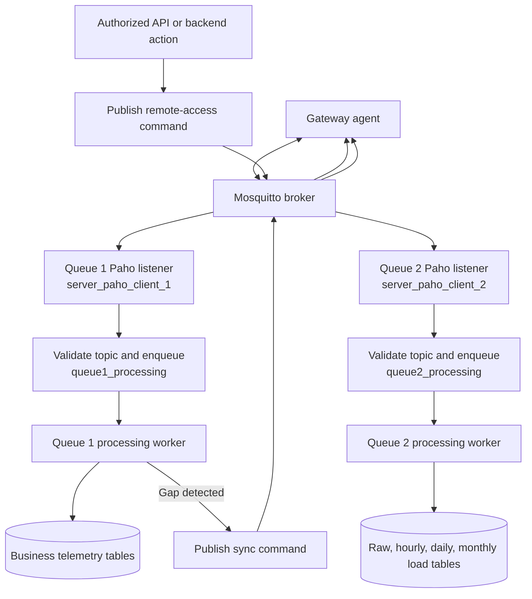
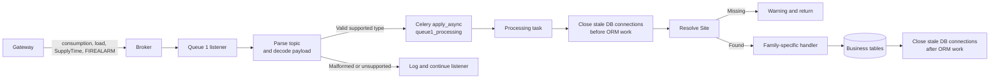
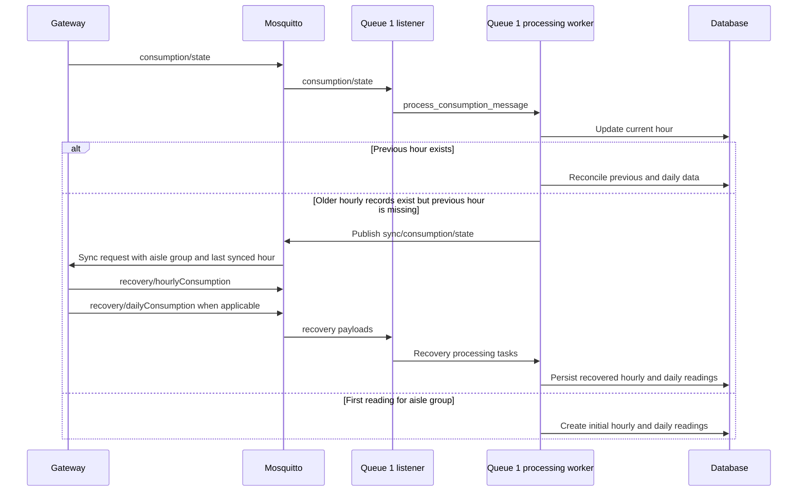
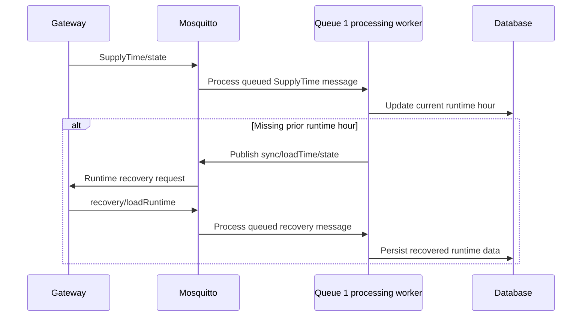
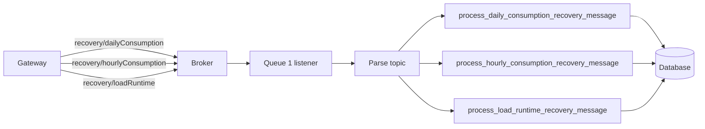
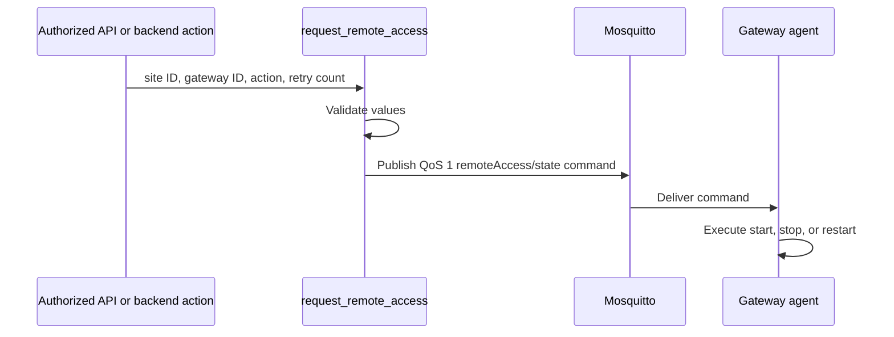
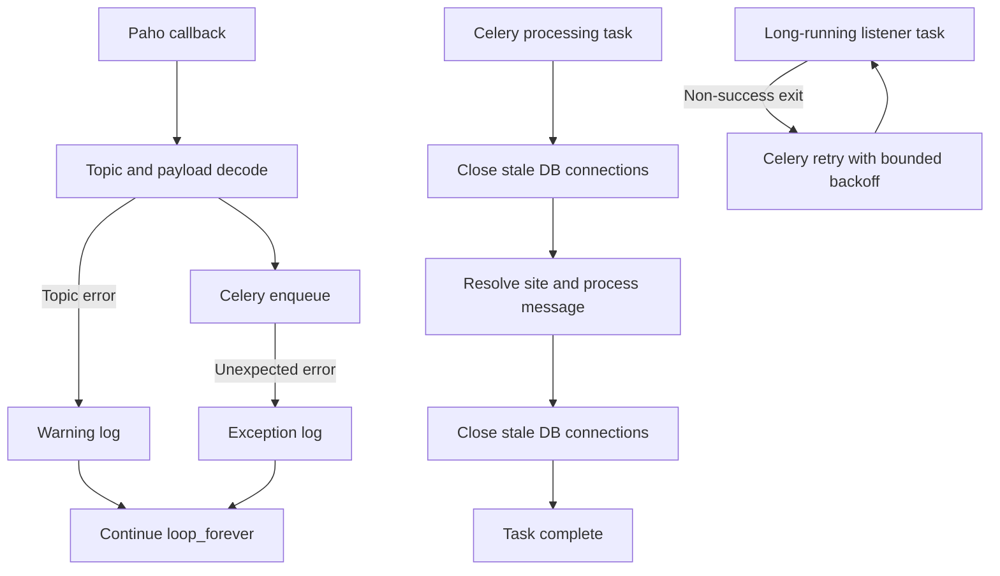

# MQTT, LoadData, and Gateway Control Flow

## Scope

This document describes the active local architecture for gateway MQTT traffic:

- Queue 1 business telemetry and recovery processing
- Queue 2 `LoadData` processing
- Consumption and SupplyTime gap recovery
- Remote-access command publishing
- Listener and database failure boundaries

The diagrams describe the local optimized code. They do not represent a deployment, migration, worker restart, or broker configuration change.

## Queue Ownership

| Queue | MQTT subscriptions | Processing queue | Responsibility |
| --- | --- | --- | --- |
| `queue1` | `consumption`, `FIREALARM`, `load`, `SupplyTime`, `recovery` | `queue1_processing` | Business telemetry and recovered readings |
| `queue2` | `LoadData` only | `queue2_processing` | Load graph raw data, monthly extrema, and rollups |

`sync` and `remoteAccess` are outbound gateway commands. They are recognized topic names but are not subscribed as inbound listener traffic.

## Full System Flow



## Queue 1 Business Telemetry



Message-family handlers:

| Message type | Processing task | Handler |
| --- | --- | --- |
| `consumption` | `process_consumption_message` | `handle_consumption_message` |
| `load` | `process_load_message` | `handle_load_message` |
| `SupplyTime` | `process_supply_time_message` | `handle_supply_time_message` |
| `FIREALARM` | `process_fire_alarm_message` | `handle_fire_alarm_message` |

## Queue 2 LoadData

```mermaid
flowchart LR
    Gateway -->|LoadData/state| Broker
    Broker --> Listener[Queue 2 listener]
    Listener --> Topic[Parse LoadData topic\nand decode payload]
    Topic -->|Valid| Enqueue[Celery apply_async\nqueue2_processing]
    Topic -->|Invalid| Log[Log and continue listener]

    Enqueue --> Worker[process_load_data_message]
    Worker --> Connections[Close stale DB connections]
    Connections --> Site[Resolve Site]
    Site -->|Missing| Missing[Warning and return]
    Site -->|Found| Parse[Parse field-based payload]
    Parse --> Aisle[AisleGroup lookup\nsite plus leg]
    Aisle --> Raw[Insert RawLoadData]
    Raw --> Graph{Load graph enabled?}
    Graph -->|Yes| Monthly[Update monthly min/max\nonly when extrema change]
    Graph -->|No| Rollup
    Monthly --> Rollup[Schedule per-site rollup]
    Rollup --> Hourly[Create missing minute extrema\nin HourlyLoadData and MainsDgLoadData]
    Hourly --> Daily{Daily rollup due\nfor this site/hour?}
    Daily -->|Yes| DailyWrite[Create missing hour extrema\nin DailyLoadData]
    Daily -->|No| Complete[Complete]
    DailyWrite --> Complete
```



Rollup safeguards:

- Raw and materialized data are streamed in chunks with only required columns.
- Each bucket retains only minimum and maximum readings.
- Inserts use batched `bulk_create` operations.
- A per-site lock prevents concurrent rollups for different minutes of the same site.
- Duplicate observed-minute rollups are skipped.
- Daily rollups are limited to one scan per completed hour per site.

## Consumption Gap Recovery



`sync` is not an inbound response. It is the server-to-gateway request. The gateway response must use `recovery` topics, which Queue 1 subscribes to.

## SupplyTime Gap Recovery



## Recovery Topic Dispatch



Unknown recovery subtypes are logged and stopped at the dispatcher. They do not enter legacy callback behavior.

## Remote Access



```text
Topic:   /Acclivate/iOmniControl/<site_id>/<gateway_id>/in/remoteAccess/state
Payload: <start|stop|restart>_<retry_count>
QoS:     1
Retain:  false
```

The backend publishes this command but does not execute gateway shell commands. Queue 1 does not subscribe to inbound `remoteAccess` traffic.

## Resilience Boundaries



The listeners use Paho reconnect delays from one to thirty seconds. Callback code does not access Django models; ORM work begins only in Celery processing tasks.

## Worker Layout

```text
celery -A warehouse worker --queues=queue1 --hostname=worker.queue1@%h --concurrency=1 --loglevel=INFO
celery -A warehouse worker --queues=queue2 --hostname=worker.queue2@%h --concurrency=1 --loglevel=INFO
celery -A warehouse worker --queues=queue1_processing --concurrency=1 --loglevel=INFO
celery -A warehouse worker --queues=queue2_processing --concurrency=1 --loglevel=INFO
```

Run one listener per listener queue. Processing queues may be scaled only after confirming database capacity, ordering requirements, and idempotency behavior for the relevant message family.
