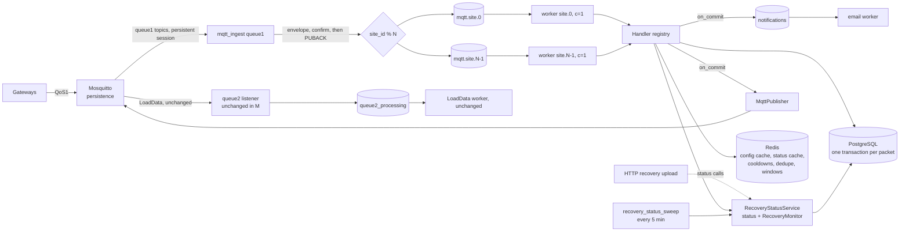
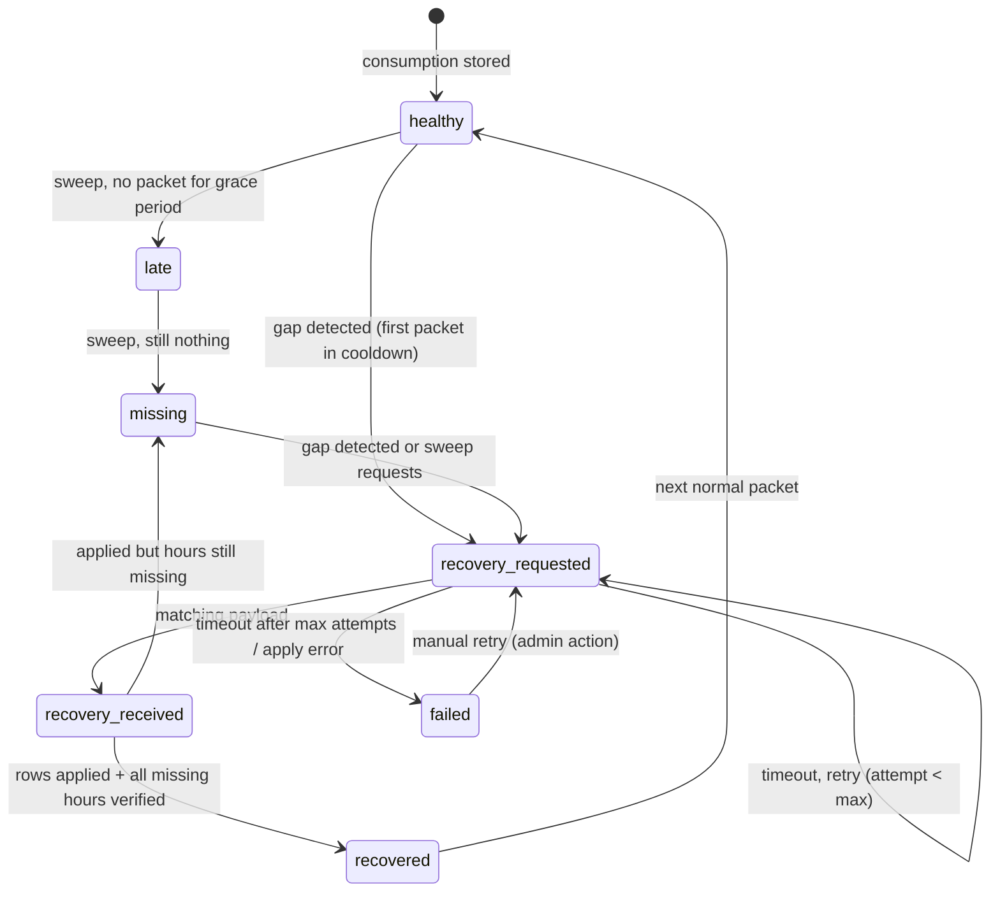

# MQTT and tasks.py Refactor Plan

Date: 2026-10-19 (rev 2: DB-hit reduction and recovery-status completion added to Phase M)
Scope: `tasks.py` (root, legacy), `wareApp/tasks.py`, `wareApp/mqtt/`, Celery/RabbitMQ/Mosquitto topology, and the database access made by the MQTT path.

Out of scope for this plan. These are not modified, only kept working:

- `wareApp/load_data/`
- `wareApp/dg_fuel/`
- `fetch_fuel_data.py`
- `wareApp/views.py`
- Monitoring/observability and broker security (separate tracks)

`wareApp/recovery/` (HTTP recovery) gets only the recovery-status calls described in M5. Its row-writing logic is not changed.

Agreed decisions this plan keeps:

| Item | Decision |
| --- | --- |
| Gap detected on `consumption` / `SupplyTime` | Keep: request recovery and return without storing the current packet. |
| `ERROR404` in hourly / loadRuntime recovery | Keep: write `0` over the existing value. |
| Hourly baseline in recovery (currently `0`) | Rebuilt later, in Phase C. |
| Recovery status (`AisleSyncRecoveryStatus` + `RecoveryMonitor`) | **Completed in Phase M (M5).** |
| DB optimization for the MQTT path (fewer hits) | **Done in Phase M (M4).** Larger DB work (partitioning, pooling) stays in Phase D. |
| DG sessions / fuel | Owned by `dg_fuel` + `fetch_fuel_data.py`. MQTT does not call them. |

Order of work:

1. Phase M: MQTT + `tasks.py` + MQTT-path DB hits + recovery status (this document)
2. Phase B: bulk creation / batching (beyond recovery)
3. Phase C: hourly baseline
4. Phase D: database (structural)
5. Phase E: alarm feature
6. Phase F: platform: versions, settings, repo hygiene. Runs in parallel once M2 is stable.

---

## 0. How the system works (domain notes, 2026-10-19)

**Data path.**
1. A gateway at each warehouse site reads its meters (Pro-Com etc.): voltage, PF, W, A and cumulative kWh.
2. It publishes them to a local topic. The gateway application stores the hourly reading and aggregates per aisle group into a daily reading.
3. It publishes all topics to the server, along with the last hour's data.
4. The server stores hourly and daily readings. Savings are baseline − consumption: PIR sensors switch aisle lights off about 20 s after nobody is underneath.

**Sync / recovery.**
- When the server finds the last hour missing, it asks the gateway (`sync`) for everything since its last stored entry.
- The gateway builds the missing-hours payload and sends it back.
- If the gateway itself was down (hung, service failure), it has no data for those hours and returns `ERROR404`. Those hours are stored as 0.
- When the gateway recovers, it reads the meter's cumulative kWh again. The whole gap's consumption (e.g. 100 → 500 kWh = 400 kWh) lands on the first hour/day after the outage.
- So **a spike after a run of zeros is genuine, not an error**. Example: site 133, zeros 07–12 Oct, then 51.37 kWh on 13 Oct.

**Baseline.**
- Daily baseline per aisle, measured before installation. The site line on the dashboard is the sum of the aisle baselines.
- It applies from the baseline start date. Example: site 197 was sampled 25–27 Sep (average 826.8 kWh) and savings start from 28 Sep.

**Supply type.**
- EL = emergency supply/lights. The aisle name contains an `EL` token (`RPC-EL`, `HB-Part-1_EL`, `EL-GF&F1`, `UCB-EL`); it runs 24 h.
- NL = every other aisle, which runs only within the site's operation window (start–end, e.g. 9–18, any length).

**High consumption / bypass** (site 183 example):
- Normal PIR days are around 100–170 kWh.
- "Normal" differs per site. Site 183 saves ~87 %, Zepto site 165 only ~37 %, because high warehouse movement keeps its lights on. That is genuine and not an alarm.
- So high consumption must be judged against **each site's/aisle's own normal daily consumption**, not a fixed share of the baseline.
- Reaching (about) the baseline means a full bypass, i.e. the sensor supply was removed (15–16 Oct). Email is sent from 90 % of the baseline. Each site has its own baseline.

## 1. Analysis of root `tasks.py` (legacy, running on main)

### 1.1 What the file contains (3,983 lines)

| Lines | Content | Status |
| --- | --- | --- |
| 1–31 | Imports (`from wareApp.models import *`, `from wareApp.sendmail import *`, `datetime.timezone` shadowed by `django.utils.timezone`), its own Celery app `Celery("root_mqtt")` | Second Celery app next to `warehouse.celery.app`. |
| 51–71 | `roadcasteAPI()` | Dead code with a **hard-coded Roadcast bearer token** (line 64). It is broken: `response["data"]` on a `requests.Response` raises, the bare `except` returns `None`. |
| 74–96 | Compatibility wrappers to `fuel_providers` / `dg_fuel` | Used only by the legacy inline code. |
| 99–2368 | `_retired_mqtt_client1_inline()` | The full legacy queue-1 logic, all inside the paho callback (details in 1.2). |
| 775 | Commented LocoNav `User-Authentication` key | **Secret in source.** |
| 2371–3795 | `_retired_mqtt_client2_inline_load_data()` | Legacy LoadData (out of scope). |
| 3799–3935 | `tasks.mqtt_client1/2` (live), `process_*` | The `process_*` functions are wrapped in `_deferred_task`, a no-op decorator, so they are **not Celery tasks**. They also reference `mqtt_publish`, which this file never imports. |
| 3946–3983 | `_retired_mqtt_client2_direct()` | Dead code. |

The copy in this folder already hands the listeners to `wareApp/mqtt/consumers.py`, which enqueues `wareApp.tasks.process_*`. The `monitoring/*.service` units start it with `celery -A tasks` and also `ExecStartPost ... call tasks.mqtt_client1`.

If the copy on main is the older, fully-inline version, everything in 1.2 is what production runs today. **First action (M0): pull main's real `tasks.py` and unit files and diff them against this copy.**

### 1.2 How the legacy queue-1 callback works

```
paho on_message (blocking, single thread)
  ├─ print() topic + payload           → every packet written to celery_logs_of_server.log
  ├─ Site.objects.get(...)             → DB query inside the MQTT callback
  ├─ "consumption" ─ positional split: data[0]..data[8]
  │     ├─ site_type == 2 → any value > 10000 replaced by 0
  │     ├─ site_type == 1 and dg_fuel_system_installed:
  │     │     DgUnitConsumption create/update, DG-overtime alarm,
  │     │     **blocking HTTP call to LocoNav/Roadcast inside the callback**
  │     │     (Roadcast chosen by a hard-coded site-ID list)
  │     ├─ SensorAisleUnitConsumption
  │     ├─ hourly update / new-hour / previous-hour resync / daily re-sum (Python loop)
  │     ├─ gap → client.publish(sync/consumption) and **continues to the daily increment**
  │     └─ daily increment + 7-day-average high/low alarm (no dedupe)
  ├─ "FIREALARM"   ─ quote-split parsing, same mode state machine as today
  ├─ "load"        ─ 2 SiteLoadParameters inserts per packet, .count() > 6, PF only if is_pf_visible and 14 fields
  ├─ "SupplyTime"  ─ hourly runtime, monthly share, gap → client.publish(sync/loadTime)
  └─ "recovery"    ─ daily / hourly (computes baseline + saving) / loadRuntime
```

### 1.3 Legacy vs modular (`wareApp/mqtt`) parity

| Behaviour | Legacy root `tasks.py` | Modular `wareApp/mqtt` | Action |
| --- | --- | --- | --- |
| Payload parsing | Field position (`data[4]`, `load[10]`); breaks if the gateway reorders fields | Key-based, alias tolerant | Keep modular |
| `site_type == 2` cap (> 10000 → 0) in consumption | Yes (587–598) | **Missing** | **Port (M1)** |
| `site_type == 2` cap in daily recovery | Yes (2098) | **Missing** | **Port (M1)** |
| DG unit sessions + fuel API in the MQTT path | Yes, blocking HTTP | Removed; `dg_fuel` + `fetch_fuel_data.py` own it | Keep removed |
| DG overtime alarm | Present but broken: uses `.filter()` instead of `.create()` (699–703), so the 2-hour throttle never records and an email can go out on every packet | Absent everywhere | Re-implement in Phase E |
| Gap on consumption | Publishes recovery, **still adds the packet to the daily total** | Publishes recovery and returns | Keep modular (agreed) |
| Hourly baseline lookup | `SiteBaseline...last()`; divides by `working_hours` without a zero/None guard (1017–1020) | Ordered by `-baseline_to`, guarded | Keep modular; rebuild in C |
| Daily re-sum from hourly | Python loop over `reading_from__date` (non-indexable) | `aggregate(Sum)` over a time range | Keep modular |
| Daily consumption alarms | 7-day average ± `max/min_threshold_value`, no dedupe | Bypass(11) / High(7) with dedupe, Low(8) legacy rule | Keep modular; finish in E |
| Meter "ERROR!!!" diagnostics | No | Yes, with a 30-minute cooldown | Keep |
| Sync status | No | `mark_*` on `AisleSyncRecoveryStatus` | Keep (WIP) |
| Recovery publish | Reuses the listener connection (`client.publish`) | `paho.publish.single()`, a new TCP connection per publish | Fix in M3 |
| SupplyTime monthly share | **Never written**: `strptime("%M %Y")` raises (1956) and the exception is swallowed | Fixed (`strftime("%m %Y")`, update-or-create) | Keep modular |
| PF values on `SiteLoadPower` | Stored only when `is_pf_visible` and the packet has 14 fields, else 0 | Stored whenever PF fields are present | **Confirm intended (M1)** |
| Hourly recovery baseline / saving | Computed (can crash with no baseline) | Forced to 0 | Phase C (agreed) |
| Daily recovery with no baseline | Crash: `.last().baseline_value` on `None` | Falls back to 0 with a warning | Keep modular |
| Recovery list handling | `range(len(x) - 1)` skips the last element (trailing comma) | Filters empty items, `zip` | Keep; add a length check |
| Logging | `print()` on every step | `logging` at INFO per packet | Out of scope (monitoring track) |

**Conclusion.** Apart from the two `site_type == 2` caps and the PF-storage question, the modular handlers are a superset of the legacy logic and fix several legacy bugs. Root `tasks.py` should leave the runtime path entirely: move it to `legacy/root_tasks_reference.py`, which workers never import.

---

## 2. Phase M: MQTT + tasks.py + DB hits + recovery status

### 2.0 Current traffic and test-server log evidence (2026-10-17)

Main receives and sends 30+ MQTT packets per second. In the test-server log for the current `wareApp/mqtt` + `wareApp/tasks.py`:

| Observation | Evidence | Consequence |
| --- | --- | --- |
| One hourly-recovery message is about a 1-second task | site 125, aisle 729: about 38 hourly rows updated one by one, ~2–3 ms each; task `succeeded in 0.956s` | Each row is its own autocommitted transaction (one WAL flush per row). The single worker processes nothing else for that second, so ~30 packets from other sites queue behind it. |
| Consumption tasks take 10–40 ms each | `succeeded in 0.010s` … `0.039s` | At ~30 queue-1 packets/s that is 0.3–1.2 s of work per second: one serial worker sits at or above saturation at peak |
| The same gap is requested again on every packet | site 198, aisle 1271: three `consumption recovery requested` for hour 15:00 within ~25 ms | Three new MQTT connections, three `AisleSyncRecoveryStatus` rewrites, and possibly three identical 1-second recovery batches back from the gateway |
| Every task returns a result | `succeeded … : None` | A result message is produced for each task, which nothing reads |

### 2.1 Current vs target at a glance

| Concern | Current | Target |
| --- | --- | --- |
| Celery apps | `root_mqtt` (root `tasks.py`) + `warehouse` | One app: `warehouse` |
| Listener process | `paho.loop_forever()` inside a Celery task, started by `ExecStartPost` **and** `worker_ready` + `inspect()` | `manage.py mqtt_ingest` systemd daemon |
| MQTT session | `clean_session=True`, QoS 0, fixed client ID | `clean_session=False`, QoS 1, broker persistence |
| Parallelism | `queue1_processing`, concurrency 1, all sites serial | `mqtt.site.{0..N-1}` partitioned by `site_id % N`; per-site order kept |
| DB round trips per consumption packet | ~11 (normal), ~17 (new hour), ~10 (gap) | ~5, ~8, ~4 (section 2.5) |
| Hourly recovery (38 rows) | ~45–85 statements, each its own commit, ~1 s | One transaction, 3 statements (1 with unique keys), one commit |
| Config lookups | Site / AisleGroup / baseline queried on every packet | `SiteConfigCache` in Redis with signal invalidation |
| Recovery status | Consumption + hourly recovery only; rewritten on every packet; `RecoveryMonitor` never written; no timeout, failure, runtime or HTTP coverage | Full state machine for consumption and runtime, `RecoveryMonitor` history, timeouts and retries, MQTT and HTTP transports (section 2.6) |
| Outbound publish | `publish.single()` per message, QoS 0, no cooldown | `MqttPublisher` per process, QoS 1, on commit, one request per gap per cooldown |
| Processing tasks | 7 near-identical tasks, ack early, no retry, every exception swallowed | One `process_mqtt_message(envelope)`, in-task DB retry, dead-letter table, `acks_late` after idempotency |
| Duplicates | Daily `F()+` increments double-count replays; no unique keys | Redis idempotency guard + unique constraints + upserts |
| Email | SMTP inline in the handler, no `EMAIL_TIMEOUT` | `notifications` queue via `transaction.on_commit` |
| Code shape | Five copies of the `key:value` parser; free functions | `payloads.py` + `MessageHandler` classes + registry |

### 2.2 Target architecture



### 2.3 Target code layout

```
wareApp/mqtt/
  envelope.py          MqttEnvelope (topic, site_id, gateway_id, type, subtype, payload, received_at, message_id)
  topics.py            (existing)
  routing.py           family → handler key; site_id → partition queue
  payloads.py          KeyValuePayload: one parser replacing four copies (load_data keeps its own)
  handlers/
    base.py            MessageHandler(ABC): parse() / handle() → HandlerResult
    consumption.py  supply_time.py  load.py  fire_alarm.py  recovery.py
  registry.py
  services/
    site_cache.py      SiteConfigCache: Site, AisleGroup pk by (site, leg), baseline
    recovery_status.py RecoveryStatusService: state machine + RecoveryMonitor (replaces sync_status.py)
    publisher.py       MqttPublisher
    idempotency.py     IdempotencyGuard
    notifications.py   enqueue_email() on commit
  ingest.py            MqttIngestService
wareApp/management/commands/mqtt_ingest.py
wareApp/management/commands/recovery_status_sweep.py
wareApp/tasks.py       process_mqtt_message(envelope), send_notification(...), aliases for old names
legacy/root_tasks_reference.py
deploy/systemd/        mqtt-ingest-queue1.service, mqtt-site-worker@.service,
                       mqtt-notifications.service, recovery-status-sweep.timer, queue2 units
```

Each handler first wraps the existing `handle_*` function unchanged. Internals are refactored only after the parity and query-budget tests pass.

### 2.4 Steps

Every step: tests first, compile check, deploy to test, soak, then main, with a rollback.

**M0. Safety net (no production change)**

1. Copy main's real `tasks.py`, unit files, `mosquitto.conf` and the RabbitMQ queue list into `legacy/` and `deploy/`, and diff them against this folder.
2. Record one day of real queue-1 payloads on the test broker as fixtures.
3. Golden tests: replay the fixtures through the handlers on a test DB and compare rows with production for the same window.
4. **Query-budget tests:** `assertNumQueries` / `CaptureQueriesContext` for each path in section 2.5, recording today's counts. Every later step must keep or lower them.

**M1. Parity fixes**

1. Add the `site_type == 2` > 10000 → 0 cap to consumption and daily recovery.
2. Decide PF storage (legacy: only when `is_pf_visible`; modular: always) and encode it in a test.
3. Recovery parsers reject mismatched hours/values lists instead of letting `zip` truncate.

**M2. One Celery app + cutover of main off root `tasks.py`**

1. All workers run `-A warehouse`. Remove `ExecStartPost`; commit the processing unit files under `deploy/systemd/`.
2. Move root `tasks.py` to `legacy/root_tasks_reference.py`.
3. Settings: `CELERY_TASK_IGNORE_RESULT = True`, `EMAIL_TIMEOUT = 10`, `CONN_HEALTH_CHECKS = True`. Configure `CACHES` with `django-redis` (already installed).
4. Cutover on main in a quiet window, comparing row counts with the M0 baseline; rollback is restarting the old units.

**M3. Partition by site + cooldown + persistent publisher** (urgent per the 2026-10-17 log)

1. `mqtt.site.0..N-1` (start N = 4) replaces `queue1_processing`, using the systemd template `mqtt-site-worker@.service` (`-Q mqtt.site.%i -c 1`). Each site stays strictly serial, so this adds no new races. Change N only with empty queues.
2. Recovery-request cooldown: `cache.add("mqtt:recovery-req:<site>:<aisle or source>", 1, 600)`. Only the first packet of a gap publishes; the rest still return without storing (agreed behaviour).
3. `MqttPublisher` (one persistent client per worker process, QoS 1), publishing via `transaction.on_commit`.
4. Emails go to the `notifications` queue on commit.

**M4. DB-hit reduction** (details in 2.5; budgets from M0 must drop)

**M5. Recovery-status completion** (details in 2.6)

**M6. Delivery guarantees**

1. Mosquitto: `persistence true`, `persistent_client_expiration 7d`, a raised `max_queued_messages`, `queue_qos0_messages true` (needed while gateways publish at QoS 0).
2. Listener: `clean_session=False`, QoS 1, client IDs and broker host/port from settings.
3. `CELERY_BROKER_TRANSPORT_OPTIONS = {"confirm_publish": True}`.
4. One `process_mqtt_message(envelope)` task:
   - transient DB errors are retried inside the task (3 tries, 0.5/1/2 s), because a Celery re-queue would put the packet behind newer packets of the same site
   - payload errors go to a new `MqttDeadLetter` row
   - handlers stop swallowing DB errors
5. Old `process_*` names stay as thin wrappers during rollout.

**M7. Idempotency + unique keys**

1. `IdempotencyGuard` keyed by `sha1(topic + payload)` (Redis `SET NX`, TTL 6 h) for consumption, recovery, load and FIREALARM.
2. SupplyTime: payload-hash dedupe is unsafe, because its payload only carries the date and hour. It needs a gateway sequence number, or stays at-most-once.
3. Duplicate-cleanup script (dry-run report first), then unique constraints:
   - `HourlySiteReading (associated_Site, leg_id, reading_from)`
   - `DailySiteReading (associated_Site, leg_id, reading_for)`
   - `SupplyLoadTimeShare (site, power_source, reading_from)`
4. Recovery writes switch to `bulk_create(update_conflicts=True, ...)`, which is one statement per message.
5. Turn on `CELERY_TASK_ACKS_LATE` and `CELERY_TASK_REJECT_ON_WORKER_LOST` (except SupplyTime without a sequence number).

**M8. Ingestion daemon**

`manage.py mqtt_ingest` with paho 2.x `manual_ack`: PUBACK only after RabbitMQ confirms. The `mqtt_client1` task, `worker_ready` handlers and `inspect()` are removed. Queue 2 moves to the same daemon only after a week of soak, with its handler logic untouched.

**Code shape** runs alongside M3–M7 in small parity-tested steps: envelope, `payloads.py`, handler classes and registry.

### 2.5 M4: DB-hit reduction (MQTT path)

**Round trips per path**, counted from the code including BEGIN/COMMIT and savepoints. M0 confirms them with `assertNumQueries`.

| Path | Today | Target | How |
| --- | --- | --- | --- |
| Consumption, current hour exists | ~11 | ~5 | Site + baseline from cache; sync status not rewritten when already healthy |
| Consumption, first packet of new hour | ~17 | ~8 | One "latest hourly row" query instead of three; merged previous-hour updates; daily re-sum as one `UPDATE … = (SELECT SUM)`; cache |
| Consumption, gap | ~10 | ~4 (repeat packets ~3) | Latest-row query; status transition written once per cooldown |
| Hourly recovery, 38 rows | ~45–85 statements, ~40 commits | 3 statements, 1 commit (1 statement after M7) | One transaction; fetch existing, `bulk_update` + `bulk_create`; status + monitor in the same transaction |
| Daily / runtime recovery, n rows | ~2n autocommits | 3 statements, 1 commit | Same pattern |
| SupplyTime, same hour | 2 | 1 | Site from cache |
| SupplyTime, new hour | ~5 | ~3 | Previous-hour check derived from the already-fetched latest row |
| Load, voltage alarms on | ~7–9 | ~2 | Redis 5-sample window instead of 2 inserts + 2 reads; `update()` then create only if 0 rows |
| FIREALARM | ~4–6 | ~3 | Site with `customer` from cache |

At ~30 packets/s this removes roughly 150–200 statements per second, and most of the commit (WAL flush) cost of recovery.

**Changes**

1. **One transaction per packet.** Each handler's DB work runs in one `transaction.atomic()`, recovery included. Today every row update in a recovery loop commits on its own, which is where the ~2–3 ms per row in the log goes.
2. **`SiteConfigCache`.**
   - Site (with `customer`), AisleGroup pk by `(site, leg)`, and latest baseline are kept in Redis, TTL 300 s.
   - `post_save` / `post_delete` invalidation on `Site`, `AisleGroup` and `SiteBaseline`.
   - `select_for_update(pk=...)` on AisleGroup stays a DB query, because it is the lock.
   - Caveat: `queryset.update()` in views fires no signal, so the TTL bounds staleness.
3. **Merge consumption lookups.**
   - The new-hour/gap branch today runs `previous_entries.first()`, `hourly_entries.exists()` and `order_by("-reading_to", "-id").first()`.
   - Replace them with one `order_by("-reading_from").first()`, using a backward index scan with LIMIT 1. The existing ordering by `reading_to` cannot use the `(site, leg, reading_from, …)` index and sorts the leg's whole history.
   - Then the latest row is the previous hour → has previous; anything else → gap with that row; none → first entry.
   - The two previous-hour `update()` calls become one, and the daily re-sum becomes one `UPDATE` with a `Subquery(Sum)`.
4. **Sync status only on transitions** (`RecoveryStatusService`, M5). The current state is cached in Redis; `healthy → healthy` does no DB write. Today every packet does `update_or_create`, which is a savepoint + SELECT FOR UPDATE + UPDATE.
5. **Load voltage window in Redis** (`LPUSH` + `LTRIM 5` per (site, source, type)). Nothing in `views.py` reads `SiteLoadParameters`; confirm no report uses it before stopping the inserts.
6. **Indexes for the MQTT queries**, added with `CREATE INDEX CONCURRENTLY` via migrations:
   - `AlarmNotifications (site_id, aisle_group, Alarm_type, created_time)` — the model has no Meta indexes. Rewrite the daily-alarm dedupe from `created_time__date=` to a time range.
   - `RecoveryMonitor (site, aisle_group, recovery_type, status, requested_at)` for "open monitor" lookups.
   - Drop the duplicate pair `idx_site_leg_time` / `idx_site_leg_time_visible` if `pg_stat_user_indexes` shows one unused.
7. **Connections.**
   - `CONN_MAX_AGE = 60` + `CONN_HEALTH_CHECKS = True`, so each worker reuses one connection.
   - Budget: N site workers + queue2 + notifications + Gunicorn + `fetch_fuel_data` stays well under `max_connections = 100`.
8. **Optional, decide.** `synchronous_commit = off` only for the MQTT worker connection (`OPTIONS: {"options": "-c synchronous_commit=off"}`). Commits stop waiting for the WAL flush. Risk: a PostgreSQL crash can lose the last fraction of a second of commits (no corruption). With the recovery mechanism that is usually acceptable, but it is a business decision.

### 2.6 M5: Recovery-status completion

**What exists today**

- `AisleSyncRecoveryStatus` (current state per site, gateway, aisle) and `RecoveryMonitor` (history), from `docs/alarm-feature-plan.md`.
- Only three transitions are written: `healthy` (consumption), `recovery_requested` (consumption gap), and `recovery_received` → `recovered` (hourly recovery).

**Gaps**

| Gap | Effect |
| --- | --- |
| `RecoveryMonitor` is never written | No request/response history, no linking |
| Status rewritten on every gap packet | `last_recovery_requested_at` keeps moving; extra writes (site 198 in the log) |
| `missing_slots` hard-coded to 1 | Gap size unknown |
| `recovered` set after any response, even partial | No verification that every missing hour now exists |
| No `late` / `missing` / `failed` / `timeout` | A gateway that never answers stays `recovery_requested` forever |
| Daily recovery and loadRuntime/SupplyTime not tracked | Runtime gaps invisible; current-state table requires an aisle |
| HTTP recovery (`wareApp/recovery/processor.py`) never updates status | Same recovery, different visibility depending on transport |
| Unsolicited recovery payloads | Marked received/recovered without any request |

**Target state machine** (from `docs/alarm-feature-plan.md`, with retry/timeout made concrete)



**Design**

1. **`RecoveryStatusService`** replaces `sync_status.py`. It is called inside the handler's transaction, so status and data commit together. Methods:
   - `on_consumption_stored`
   - `on_gap(missing_from, missing_to) -> should_publish`
   - `on_response(recovery_type, payload)`
   - `on_applied(rows, error_slots)`
   - `verify()`
   - `on_timeout()`

   It writes only on a state change, with the current state cached in Redis and refreshed after commit.
2. **Gap → request.**
   - Create a `RecoveryMonitor` (`requested`) with `missing_from` = last stored hour + 1 h, `missing_to` = observed hour, `expected_slots` = hours between, and the request topic and payload.
   - Link it as `status.recovery_monitor` and publish on commit.
   - Repeat packets inside the cooldown write nothing. The cooldown key and the open monitor replace today's per-packet `update_or_create`.
3. **Response.**
   - Match the newest open monitor for (site, aisle or power source, type).
   - Store `mqtt_response_payload` and `response_received_at`, apply rows in the same transaction, and set `recovered_slots` and `error_slots` (count of `ERROR404`, still written as 0 per the agreed rule).
   - No open monitor → create one directly as `response_received` (unsolicited), so history is complete.
4. **Verify.** One `count()` of hourly rows in `[missing_from, missing_to)` against `expected_slots`.
   - All present → monitor `verified`, status `recovered`.
   - Otherwise status `missing` with the remaining slot count.
   - `ERROR404` hours count as resolved: the gateway has no data, and asking again will not change that. The monitor keeps `error_slots > 0`, and the status records `recovered` with data loss, so it is not retried forever.
5. **Mark the catch-up spike.** After an outage with `error_slots > 0`, the first hour/day with data after the last `ERROR404` slot carries the whole gap's consumption (the meter's cumulative difference).
   - The monitor records that hour and date (`catch_up_at`).
   - Phase E alarms read it, so a genuine catch-up spike is not reported as high consumption or bypass, and the dashboard can label it.
   - Readings themselves are not changed (the agreed `ERROR404` → 0 rule stays).
6. **Daily recovery** writes its own monitor (`daily_consumption`) linked to the same request, and does not change the aisle status. Hourly verification decides that.
7. **Runtime (SupplyTime / loadRuntime).** `AisleSyncRecoveryStatus` gets a nullable `power_source`, and `aisle_group` becomes nullable, with two partial unique constraints:
   - `(site, home_gateway_id, aisle_group)` where the aisle is set
   - `(site, home_gateway_id, power_source)` where the source is set

   SupplyTime gaps and loadRuntime responses use the same flow with `recovery_type = load_runtime`.
8. **Sweep** (`manage.py recovery_status_sweep`, systemd timer every 5 min):
   - `healthy` → `late` → `missing` by `last_sync_at` age
   - open monitors past the timeout → `timeout`, then a re-request until max attempts, then `failed`
   - The sweep only reads indexed status/monitor rows; it never scans reading tables.
9. **HTTP transport.** `wareApp/recovery/processor.py` keeps its row logic and only calls `RecoveryStatusService.on_response/on_applied/verify`, the same as the MQTT handlers. `wareApp/recovery/service.py` is already the stub meant for this shared entry point.
10. **Admin.** `AisleSyncRecoveryStatus` and `RecoveryMonitor` admin with filters (status, site, gateway, aisle, type), plus a "retry" admin action for `failed`.
11. **Tests.** Table-driven transition tests, including the site 198 repeat-gap case (one monitor, one publish), the 38-row site 125 recovery (one transaction, verified), timeout/retry/failed, an unsolicited payload, and the HTTP path.

**Proposed defaults, to confirm** (`docs/alarm-feature-plan.md` decision 5)

| Setting | Proposed |
| --- | --- |
| Request cooldown / response timeout | 10 min |
| Max request attempts before `failed` | 3 |
| `late` after no consumption for | 70 min |
| `missing` after | 130 min |

### 2.7 Celery / RabbitMQ settings (target)

```python
CELERY_BROKER_URL = config("CELERY_BROKER_URL")            # RabbitMQ stays the broker
CELERY_RESULT_BACKEND = None
CELERY_TASK_IGNORE_RESULT = True
CELERY_BROKER_TRANSPORT_OPTIONS = {"confirm_publish": True}
CELERY_BROKER_CONNECTION_RETRY_ON_STARTUP = True
CELERY_WORKER_PREFETCH_MULTIPLIER = 1
CELERY_TASK_ACKS_LATE = True                               # only after M7
CELERY_TASK_REJECT_ON_WORKER_LOST = True                   # only after M7
MQTT_SITE_PARTITIONS = 4
```

Redis: config cache, status cache, cooldowns, idempotency and voltage windows. RabbitMQ stays the Celery broker for durability and publisher confirms.

### 2.8 Exit criteria for Phase M

- Golden-fixture parity: identical rows versus the production window, except the agreed fixes.
- Query budgets: every path at or below the target column in 2.5.
- The 38-row hourly recovery runs in one transaction and finishes in tens of milliseconds, not ~1 s (to be measured on test).
- Oldest-message age stays under 30 s at peak; a recovery batch or SMTP stall no longer delays other partitions.
- Recovery status: every gap has exactly one open monitor; every response is linked; timeouts lead to retry, then `failed`; HTTP and MQTT give the same status.
- Restarting any listener or worker under live traffic loses nothing, and replaying a fixture twice adds no rows or increments.
- Root `tasks.py` is no longer imported by any process on main.

---

## 3. Later phases (outline; each gets its own detailed plan)

**Phase B. Bulk creation / batching**

- Alarm and dead-letter writes batched per task.
- Optional raw LoadData `bulk_create` in a bounded window (1 s or 100 rows), as in the existing LoadData roadmap. This is a transport-level change; parsing and rollups are not touched.

**Phase C. Hourly baseline**

- One `BaselineService` used by consumption, recovery, alarms and (later) views. It picks the `SiteBaseline` row whose date range contains the date, else the latest one.
- **Supply type per aisle.** `EL` if the name contains `EL` as a token, separated by the start/end of the name, `-`, `_`, `&`, `/` or a space. That matches `RPC-EL`, `HB-Part-1_EL`, `EL-GF&F1`, `UCB-EL`, `C&S-EL`, but not `SHELTER` or `Wall-Lights`. Everything else is `NL`.
  - The rule in `docs/alarm-feature-plan.md` (start/end, hyphen, space only) misses `HB-Part-1_EL`; this widens it.
  - An explicit per-aisle override field covers odd names.
- **Hourly baseline per aisle:**
  - EL: `daily_baseline / 24` for every hour.
  - NL: `daily_baseline / NL operation hours` for hours inside the site's window (start–end; crossing midnight allowed), and `0` outside it.
  - Check: for every aisle and day, the 24 hourly baselines sum exactly to the daily baseline. The site's hourly line is the sum over its aisles.
- **Site settings** (from the alarm plan): `nl_operation_start_time`, `nl_operation_end_time` (hours derived from them), and the baseline start date.
- Fill `hourly_baseline_value` / `energy_saved` in hourly recovery (today forced to 0), and backfill history with a dry-run report.
- Note: `ERROR404` days store 0 and so show a full day's "saving", and the catch-up day shows a negative one. Totals over the period are right, but day-level savings are distorted. Using the M5 catch-up marker, the dashboard can flag these days; whether to spread the catch-up over the outage days is a business decision (open question 10).

**Phase D. Database (structural)**

- `pg_stat_statements` review across the whole app.
- Monthly partitioning or retention plus rollup for `RawLoadData`, `HourlySiteReading`, `PowerFactorData`.
- psycopg 3 with Django's connection pool, or PgBouncer.
- Autovacuum tuning for high-churn tables; replace the `jsonfield` package with Django `JSONField`.

**Phase E. Alarm feature**

- Implement `docs/alarm-feature-plan.md` in an `alarms` queue evaluated on hour/day close, not on every packet.
- **Levels**, as a share of the daily baseline, evaluated per aisle (to show which aisle is bypassed) and for the site total:

  | Level | Rule (per-site configurable) | Action |
  | --- | --- | --- |
  | Normal | below the high threshold | — |
  | High consumption | ≥ 50 % of baseline, or a configured absolute value (e.g. 250 kWh) | Alarm; also run the operation-hours check |
  | Bypass warning | ≥ 90 % of baseline | Email |
  | Full bypass | ≥ 100 % of baseline | Alarm (supersedes high consumption) |

- **Operation hours increased** (NL only): hourly consumption above an activity threshold outside the site's NL window, or more active hours than configured. Linked to a high-consumption alarm as its likely cause.
- **Recovery catch-up days are excluded:** when the M5 monitor marks a day as a catch-up spike after `ERROR404` slots, no high-consumption or bypass alarm is raised for it.
- Alarms are idempotent per (site, aisle, type, date). Emails go through the notifications queue.
- Re-implement the DG-overtime alarm correctly (the legacy version never persisted).

**Phase F. Platform** (parallel, after M2)

- Python 3.10 → 3.12 (3.10 reaches end of life in October 2026).
- Django 5.2.1 → latest 5.2.x LTS patch.
- `paho-mqtt` 1.6.1 → 2.x (needed in M8); `psycopg2-binary` → `psycopg` 3.
- One pinned requirements lock file; check current releases before pinning.
- One `settings/` package (base / prod / test / local) replacing the five settings files; secrets only from env.
- Remove backup files from the tree (`views12_26.py`, `*tasks.py.bck`, `10Aprtasks.py`, …); logs, dumps and `*.sqlite3` out of the repo; main deploys from git tags.
- CI runs `wareApp.tests` + ruff on every push.

---

## 4. Open questions

1. Is main's `tasks.py` the same as this folder's copy (delegating), or the older fully-inline version?
2. PF storage on `SiteLoadPower`: legacy rule (only when `is_pf_visible`) or current rule (always)?
3. SupplyTime idempotency: firmware sequence number/timestamp, or accept at-most-once?
4. Is `SiteLoadParameters` read by any report or external tool?
5. Can the gateway firmware publish at QoS 1?
6. Recovery defaults in 2.6 (cooldown/timeout, max attempts, late/missing thresholds): accept or change?
7. Does one `sync/consumption` request make the gateway send both `hourlyConsumption` and `dailyConsumption`, or only hourly?
8. After a verified hourly recovery, should `DailySiteReading` be re-summed from hourly (the alarm plan says yes), or keep relying on the gateway's daily recovery value?
9. `synchronous_commit = off` for MQTT worker connections: yes or no?
10. Catch-up spikes after `ERROR404`: only flag them (dashboard label, alarm suppression), or also spread the recovered kWh across the outage days for day-level savings?
11. High consumption: is the rule "≥ 50 % of baseline" or a per-site absolute value (250 kWh on site 183), and does it apply per aisle, per site total, or both?
12. NL hourly baseline outside the operation window: 0 (so 24 hourly values sum to the daily baseline)?
13. Can an aisle name carry an explicit `NL` token (e.g. `HB-Part-1_NL`), or is NL always "not EL"?
