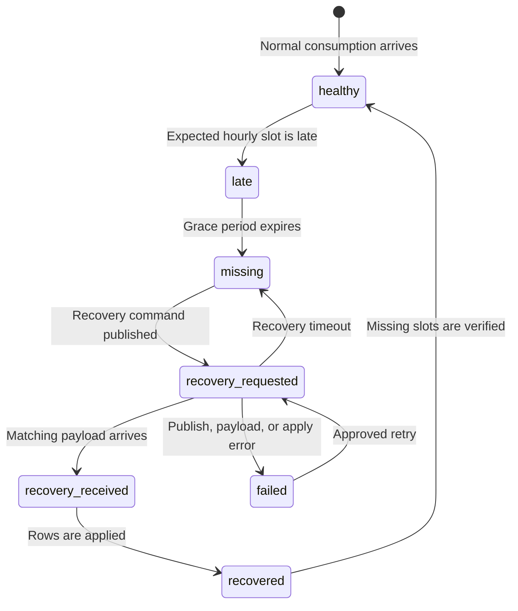

# Alarm Feature Plan

## Purpose

This document defines the proposed design for:

- Meter Reading Issue storage without outbound email.
- Per-aisle sync and recovery status.
- Baseline-driven High Consumption, Low Consumption, bypass, and increased-operation-hours alarms.

This is a design proposal only. No new alarm rule in this document is active until the design is approved and implemented.

## Current Building Blocks

| Existing item | Current use | Proposed role |
| --- | --- | --- |
| `SiteBaseline` | Stores a daily baseline and legacy working hours for an aisle group. | Authoritative daily baseline for consumption calculations. |
| `HourlySiteReading` | Stores hourly consumption and an hourly baseline. | Detect hourly activity, gaps, extra operation hours, and recovery completion. |
| `DailySiteReading` | Stores daily consumption and daily baseline. | Evaluate daily High Consumption and Low Consumption alarms. |
| `AlarmNotifications` | Stores consumption and Meter Reading Issue alarms. | Store the new baseline-driven alarm events. |
| `RecoveryMonitor` | Stores each requested recovery, response, application, verification, failure, or timeout. | Keep immutable recovery history. |

## Source Classification And Effective Operation Hours

Every aisle group is classified from its `AisleGroupName`.

| Classification | Name rule | Effective operation hours |
| --- | --- | --- |
| EL: emergency or UPS supply | The name contains an uppercase standalone `EL` token, for example `EL-MTS` or `MTS-EL`. | Always `24` hours. |
| NL: normal supply | Every other aisle group. | The site-wide configured NL operation hours. |

The proposed classifier is case-sensitive and token-based: `EL` must be bounded by the start/end of the name, a hyphen, or whitespace. Therefore `EL-MTS` and `MTS-EL` are EL; lowercase `el` and unrelated text such as `SHELTER` are not EL.

### Proposed Site Settings

Add the following fields to `Site`:

| Field | Type | Rule |
| --- | --- | --- |
| `nl_operation_hours` | Decimal or positive integer | Required for sites using NL baseline alarms; valid from `1` to `24`. All NL aisle groups at the site use this value. |
| `nl_operation_start_time` | Time | Required to identify the beginning of the configured NL operating window. |
| `nl_operation_end_time` | Time | Required to identify the end of the configured NL operating window. Together with the start time, it must represent `nl_operation_hours`, including a window that crosses midnight. |
| `consumption_activity_threshold` | Decimal | Smallest hourly kWh treated as active operation; default proposed as `0.01`. |
| `baseline_near_percent` | Decimal | Tolerance used to mark an aisle as near its daily baseline; default must be approved before implementation. |
| `high_consumption_baseline_percent` | Decimal | Percentage of the original daily baseline that triggers High Consumption; proposed initial value: `75`. |
| `high_consumption_units` | Decimal | Per-site or per-aisle daily-unit threshold derived from valid `DailySiteReading` history. |
| `bypass_consumption_units` | Decimal | Per-site or per-aisle daily-unit threshold at which the aisle is treated as bypassed. It must be greater than the high-consumption threshold. |

`SiteBaseline.working_hours` remains historical data. New calculations use `SiteBaseline.baseline_value` divided by the effective operation hours above, rather than silently changing legacy baseline rows.

## What The Site Baseline Means

The daily `SiteBaseline.baseline_value` is the measured electricity usage before the Aviconn IoT/PIR product was installed. It is not the expected post-install consumption.

The PIR system switches aisle lighting according to movement. Therefore, post-install consumption varies with site movement:

- More movement keeps lights on for longer and produces higher consumption and lower savings.
- Less movement lets lights remain off for longer and produces lower consumption and higher savings.

For example, an aisle with a pre-IoT baseline of `100` kWh may average `50` kWh after PIR installation. That represents approximately `50%` saving. If that aisle later reaches `75` kWh, it is consuming `75%` of its original baseline and should be investigated as High Consumption even though it is still below `100` kWh.

The site baseline start date identifies the point after which PIR savings are measured. The implementation will use the existing baseline effective date range and the approved site-level installation/start date to ensure pre-install readings do not affect post-install averages or alarms.

The dashboard examples follow this principle: Zepto has lower saving because it has more movement, while the Purple site has much higher saving because its movement pattern permits longer PIR-controlled off periods.

### Confirmed Daily Reading Example

For the example site/aisle profile shown in the dashboard, valid normal daily consumption is approximately `100` to `162` units. These values are taken from individual `DailySiteReading` rows, not from the aggregate site baseline chart line.

| Daily aisle consumption | Classification |
| --- | --- |
| `100` to `162` units | Normal PIR-controlled consumption. |
| `250` units or greater | High Consumption. |
| `400` units or greater | Bypassed. This supersedes High Consumption because it is the more severe state. |

The `250` and `400` limits must be stored as configurable daily thresholds for the applicable site or aisle group. They must not be applied globally to every site: baseline size, normal traffic, and PIR savings differ by site and aisle.

### Observed Daily Site Reading Example

For the provided site dashboard example, the normal aggregate `DailySiteReading` consumption is approximately `100` to `162` kWh per day. The observed interpretation for that site is:

| Daily site consumption | Operational meaning |
| --- | --- |
| Approximately `100` to `162` kWh | Regular, valid consumption. |
| Approximately `2250` kWh | High Consumption event. |
| Greater than `400` kWh | Bypassed event. |

These are site-level DailySiteReading observations, not replacements for an individual aisle baseline. They must be stored with the site, reading date, total daily consumption, and the individual aisle readings that contributed to the total.

Because `2250` is also greater than `400`, the implementation needs an explicit precedence rule before activation. The proposed rule is to record both facts on the same daily reading: create a `Bypassed` alarm because the bypass threshold is crossed, and preserve `High Consumption` as a linked severity/cause when the extreme-consumption condition is met. This keeps the operational meaning of both thresholds instead of losing one through an `if`/`elif` branch.

## Baseline Calculations

For one aisle group on one day:

$$
\text{effectiveHours} =
\begin{cases}
24 & \text{for EL} \\
\text{site.nlOperationHours} & \text{for NL}
\end{cases}
$$

$$
\text{hourlyBaseline} = \frac{\text{dailyBaseline}}{\text{effectiveHours}}
$$

The High Consumption threshold is selected from the configured per-aisle daily-unit threshold when one exists. Otherwise, the approved percentage of the original daily baseline is used:

$$
	ext{highConsumptionThreshold} =
\begin{cases}
	ext{configuredHighConsumptionUnits} & \text{when configured} \\
	ext{dailyBaseline} \times \frac{\text{highConsumptionBaselinePercent}}{100} & \text{otherwise}
\end{cases}
$$

$$
\text{nearBaseline} \iff
\left|\text{dailyConsumption} - \text{dailyBaseline}\right|
\leq \text{dailyBaseline} \times \frac{\text{baselineNearPercent}}{100}
$$

The selected `SiteBaseline` must be the row for the site and aisle whose effective date range includes the reading date. If no dated row exists, the latest baseline row for that site and aisle is used, matching the current recovery behavior. If no baseline exists, no baseline-driven alarm is evaluated and a configuration warning is logged.

## Proposed Alarm Rules

### High Consumption

One `High Consumption` alarm is created per aisle per date from its `DailySiteReading` when daily consumption reaches or exceeds the configured High Consumption threshold:

$$
	ext{dailyConsumption} \geq \text{highConsumptionThreshold}
$$

The confirmed example profile uses `250` daily units. The proposed `75%` baseline calculation remains the fallback only for a site or aisle without an explicit daily-unit threshold.

The stored record includes the site, aisle group, meter/leg ID, daily consumption, original baseline, calculated high threshold, effective operation hours, source classification, PIR baseline start date, and reading date. It is deduplicated by site, aisle group, alarm type, and date.

### Low Consumption

One `Low Consumption` alarm is created per aisle per date when the final approved low-consumption condition is met. The current application has percentage threshold fields, but the new design should use a clearly defined baseline-based condition rather than the current seven-day average.

Recommended initial rule for approval:

$$
\text{dailyConsumption} < \text{dailyBaseline} \times \left(1 - \frac{\text{lowConsumptionPercent}}{100}\right)
$$

`lowConsumptionPercent` should be a site setting or a confirmed reuse of the current `Site.min_threshold_value`.

### Bypassed

When a `DailySiteReading` reaches or exceeds its configured bypass threshold, create or update a non-email `Bypassed` alarm for the aisle. The confirmed example profile uses `400` daily units.

The Bypassed state supersedes High Consumption for that aisle/date. The record retains the actual consumption, baseline, high threshold, bypass threshold, classification, and time it was first detected. A bypass alarm is not inferred from the aggregate site chart; it is evaluated only from the individual aisle's daily reading.

### Increased Operation Hours

For NL aisles only, count hourly readings at or above the activity threshold. If active usage occurs outside the configured NL start/end window, or active-hour count exceeds `nl_operation_hours`, create an `Operation Hours Increased` alarm.

When the same aisle and day also meet the High Consumption threshold, link the two alarm evaluations and set the High Consumption cause to `operation_hours_increased`. This lets operations distinguish high movement within normal hours from consumption caused by the client operating beyond agreed hours.

Each alarm stores:

- Site, home gateway, aisle group, and leg/meter ID.
- Configured NL operation hours and observed active hours.
- Daily baseline and hourly baseline.
- First and last extra active hour.
- The date and source classification.

EL aisles are excluded because their effective operating duration is always 24 hours.

## Sync And Recovery Status Model

`RecoveryMonitor` remains the append-only recovery request history. Add a separate current-state model named `AisleSyncRecoveryStatus` so operations can see whether sync is presently healthy without interpreting many recovery rows.

| Field | Purpose |
| --- | --- |
| `site` | Site identifier. |
| `home_gateway_id` | Gateway identifier that sent or should send consumption. |
| `aisle_group` | Aisle room reference. |
| `leg_id` | Meter or leg identifier. |
| `sync_status` | `healthy`, `late`, `missing`, `recovery_requested`, `recovery_received`, `recovered`, `failed`, or `unknown`. |
| `is_sync_gone` | True when expected consumption data is missing beyond the grace period. |
| `recovery_requested` | True after a recovery command is published and until a verified result is applied. |
| `recovery_received` | True when a matching recovery payload arrives. |
| `last_sync_at` | Timestamp of the last normal consumption record. |
| `last_recovery_requested_at` | Timestamp of the latest recovery command. |
| `last_recovery_received_at` | Timestamp of the latest recovery payload. |
| `last_recovery_applied_at` | Timestamp after recovered rows are persisted. |
| `expected_from` and `expected_to` | Missing time range used for the recovery request. |
| `missing_slots` and `recovered_slots` | Quantified gap and recovery result. |
| `last_error` | Safe diagnostic message for a failed request or payload. |
| `updated_at` | Automatic current-state timestamp. |

There is one current-status row per `(site, home_gateway_id, aisle_group)` combination. Every state transition links to the associated `RecoveryMonitor` row where available.

### Sync State Flow

## Processing Sequence

1. A normal consumption packet updates hourly and daily readings and marks the aisle sync status `healthy`.
2. A missing hourly slot creates or updates the current status as `missing`, records the expected range, and creates a `RecoveryMonitor` row as `requested`.
3. Publishing the recovery command updates the same status to `recovery_requested`.
4. A recovery payload marks the status `recovery_received`, links it to the recovery history, applies rows, and calculates any daily rollup again.
5. Verification marks the status `recovered` and then `healthy`; an incomplete result stays `missing` or becomes `failed` with its remaining missing-slot count.
6. After every hourly or daily update, baseline-driven alarms evaluate once for that aisle and date using idempotent keys. The evaluation uses the pre-IoT baseline, configured High Consumption percentage, and NL start/end window.

## Data And Admin Visibility

Add Django admin support for:

- Site NL operation settings.
- `AisleSyncRecoveryStatus`, filterable by status, site, gateway, and aisle.
- Recovery history through the existing `RecoveryMonitor` records.
- Alarm history filtered by High Consumption, Low Consumption, Possible Bypass, Operation Hours Increased, and Meter Reading Issue.

No alert email is part of this phase. Alarms are stored for review in the dashboard/admin panel.

## Implementation Phases

1. Add Site operation-hour settings and the `AisleSyncRecoveryStatus` model with migrations, admin, indexes, and model tests.
2. Instrument normal consumption and all recovery handlers to update current sync state and existing recovery history atomically.
3. Centralize baseline selection, EL/NL classification, and hourly-baseline calculation in one helper with unit tests.
4. Add daily High Consumption, Low Consumption, and Bypassed alarms with idempotent storage.
5. Add Increased Operation Hours statuses after the active-hour rules are confirmed.
6. Deploy to test, validate with controlled MQTT/recovery payloads, inspect the admin records, then promote only after approval.

## Decisions Needed Before Implementation

1. Confirm the exact NL operating start and end time for each site. The resulting window must match the configured NL operation hours.
2. Confirm the site/aisle scope for the validated `250` High Consumption and `400` Bypassed thresholds. The proposed `75%` baseline calculation remains a fallback for profiles without explicit thresholds.
3. Confirm whether existing `Site.min_threshold_value` should be reused as the Low Consumption percentage, or whether a new site-level percentage is required.
4. Confirm the site-level PIR baseline/install start date field to use when separating pre-install and post-install readings.
5. Confirm the recovery grace period before a recovery is requested and its retry/timeout policy.
6. Confirm that the case-sensitive standalone `EL` naming rule is correct for all existing aisle names.