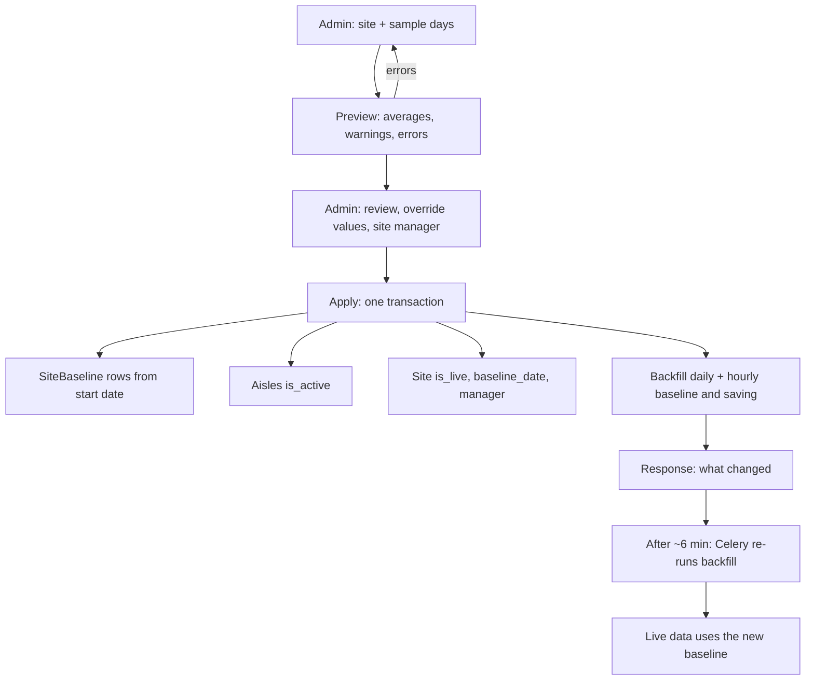

# Automatic baseline setup

One API call replaces the manual baseline steps. Since 2026-11-05; code in
`wareApp/baseline_setup.py`, API view `BaselineSetup` in
`wareApp/views/baseline.py`.

## What it replaces

The manual process (as done for Yusen Logistics Indore, site 198, on 4 Nov):

1. Pick the baseline sample days (e.g. 29-31 Oct) and average each aisle's daily
   consumption by hand (e.g. MTS-FANS(G+3): 151.76 kWh).
2. Enter each aisle's value with **Set Baseline** for a date.
3. Re-enter the baseline for every day from the baseline date until today,
   because Set Baseline writes one day only.
4. Tick `AisleGroup.is_active` for every aisle (without it no baseline or saving
   is stored for the aisle).
5. Set `Site.is_live` and the baseline date on the site.
6. Fill in the site manager, contact and e-mail.

What was still wrong after the manual steps on site 198 (checked on main, read
only): the hourly baseline and saving of 1-3 Nov stayed 0 and 4 Nov was only
partly filled, because Set Baseline never touches hourly rows.

## Workflow

### Who does what

```
 Admin (frontend)                         Server (POST /api/baselineSetup/)
 ────────────────                         ─────────────────────────────────
 1. Pick site + sample days ───────────►  2. PREVIEW (apply: false) - changes nothing
    (e.g. 29–31 Oct), optional               • per aisle: daily kWh of each sample day
    start date (default: next day)           • average = baseline (0 / missing days left out)
                                              • warnings: no data, 0 kWh, < 24 hours,
                                                Meter Reading Issue that day
                                              • errors: aisle with no usable day,
                                                later baseline exists, bad dates
 3. Review the table  ◄──────────────────     returns the plan
    • edit any aisle's value (override)
    • fill site manager name/contact/email
 4. Click "Set baseline" ──────────────►  5. APPLY (apply: true) - one transaction
                                              a. Baseline rows from the start date
                                                 (open old baseline ends the day before;
                                                  same date again = update)
                                              b. Aisles set is_active
                                              c. Site: is_live, live_date (if empty),
                                                 baseline_date, site manager
                                              d. Backfill start date → now:
                                                 daily  = baseline, saving = baseline - used
                                                 hourly = daily/24 (EL) or daily/NL hours,
                                                          saving = hourly - used
                                              e. Log line: who, date, values, rows changed
 6. Sees result  ◄───────────────────────     returns rows created/updated + backfill counts
                                          7. ~6 min later: Celery re-runs the backfill
                                             (hours stored while workers still cached
                                              the old baseline get fixed)
                                          8. From then on: live packets use the new
                                             baseline automatically every hour/day
```

### Flowchart



### Example: Yusen Indore (site 198)

| Step | What happens |
|---|---|
| Preview 29–31 Oct | MTS-FANS(G+3): 149.20 / 152.90 / 153.17, so a baseline of **151.76** (the same for the other 5 aisles) |
| Review | No warnings on main's data. The site total is 788.4 kWh/day. |
| Apply | Baselines from 1 Nov, all 6 aisles active, site live with baseline date 1 Nov. Daily and hourly rows for 1 Nov to now are filled in. |
| After | Each day's saving = 788.4 − the day's consumption, e.g. 1 Nov: 788.4 − 150.6 = 637.8 kWh |

### Rebaselining later

Run the same steps with new sample days. The old baseline ends the day before
the new start date; days before that keep their old baseline and saving.

## The rules (agreed 2026-11-05)

| # | Point | Rule |
|---|---|---|
| 1 | Who | Super_Admin users only (`UserType` 1); others get 403. |
| 2 | Baseline value | Per aisle: the average of its daily consumption over the sample days. Days without data or with 0 kWh are left out of the average and listed as warnings. Any aisle's value can be overridden. |
| 3 | Start date | `effective_from`, default = the day after the last sample day. Cannot be in the future. Sample days must be complete days before today, at most 31. |
| 4 | Preview first | `apply` false (default) returns the plan and changes nothing. `apply: true` writes everything in one transaction (all or nothing). |
| 5 | One call does every step | SiteBaseline rows from `effective_from` (an open previous baseline is closed the day before; the same date again updates it); the aisles `is_active`; the site `is_live`, `live_date` (when empty) and `baseline_date`; site manager name / contact / e-mail when given. |
| 6 | Backfill | From `effective_from` to now: every daily row gets the baseline and saving (= baseline - consumption); every hourly row its hourly baseline (daily / 24 for EL aisles, daily / NL hours on sites with NL hours, see `mqtt/services/baseline.py`) and saving. The backfill runs again about 6 minutes later (Celery task `refresh_baseline_backfill`), because workers may still use the old baseline from their 5-minute cache for hours stored in between. |
| 7 | Not touched | Days before `effective_from`. No alarms or e-mails are raised for backfilled days. |
| 8 | Rebaselining | A live site can be rebaselined the same way. An `effective_from` before an existing later baseline is refused. |

## API

`POST /api/baselineSetup/` (token, Super_Admin)

```json
{
  "site_id": 198,
  "sample_from": "2026/10/29",
  "sample_to": "2026/10/31",
  "effective_from": "2026/11/01",
  "legs": ["1268", "1269"],
  "overrides": {"1273": 45.0},
  "site_manager": {"name": "...", "contact": "...", "email": "..."},
  "apply": false
}
```

Only `site_id`, `sample_from` and `sample_to` are required. Dates are
`YYYY/MM/DD` (as the other baseline APIs) or `YYYY-MM-DD`. Without `legs`,
all aisles of the site are set.

**Response (preview):**

```json
{
  "status": 200,
  "applied": false,
  "plan": {
    "site_id": 198, "site_name": "...", "sample_from": "2026/10/29", "sample_to": "2026/10/31",
    "effective_from": "2026/11/01",
    "aisles": [
      {"leg_id": "1268", "aisle_name": "MTS-FANS(G+3)", "is_active": true,
       "days": {"2026/10/29": 150.12, "2026/10/30": 151.88, "2026/10/31": 153.28},
       "average": 151.76, "override": null, "baseline": 151.76, "warnings": []}
    ],
    "site_total": 788.4,
    "errors": []
  }
}
```

**Warnings** (shown, apply still allowed): a day without data or with 0 kWh
(left out of the average); a day with fewer than 24 hourly rows; a Meter
Reading Issue on a sample day.

**Errors** (apply refused, HTTP 400 on apply): an aisle without any usable
sample day and no override; a later baseline exists after `effective_from`;
bad dates; unknown `site_id` / `legs` / override legs.

**Response (apply)** adds `"applied": true` and
`"result": {"baselines": {"1268": "created" | "updated"}, "backfill": {"daily": n, "hourly": n}, "site": {...}}`.

Every apply is logged (Celery / gunicorn log): `Baseline setup applied:
site=... user=... effective_from=... sample=... values={...} backfill={...}`.

## Suggested frontend flow

Full spec for the frontend developer (screen, fields, request / response, errors): [BASELINE_SETUP_FRONTEND.md](BASELINE_SETUP_FRONTEND.md).

1. Select site, the sample days (from / to) and optionally the start date.
2. Call with `apply: false` and show the per-aisle table: each sample day,
   average, warnings, an editable baseline (sent as `overrides`) and the
   site manager fields.
3. **Set baseline** calls the same body with `apply: true`.

The existing APIs (`saveBaseline/`, `fetchBaseline/`, `baselineHistory/`) still
work.

## Fix in the old Set Baseline API

`POST /api/saveBaseline/` crashed for an aisle's **first** baseline (it read
`baseline_data[0]` of an empty result). It now stores the row with the aisle's
`attached_leg_id` and sets that day's daily baseline.

## Tests

`wareApp/tests/test_baseline_setup.py`: preview averages and warnings and
changes nothing; apply does every step and backfills only from the start date
(old baseline closed the day before); NL hours vs EL aisles; same date updates;
refused cases; aisle without sample data needs an override; the refresh task;
API preview then apply; Super_Admin only; bad input; the `saveBaseline` first
baseline fix.

## Rolling back

Revert the commit (see [CHANGELOG](../CHANGELOG.md)) and redeploy; on the test
server the previous files are in `~/django_project/backups/deploy/` (named in
the change log). An applied baseline is ordinary data: SiteBaseline rows can be
edited in Django admin, and `rebuild_hourly_baseline` / `resync_daily_totals`
recompute hourly and daily rows.
