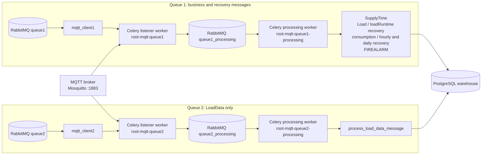

# MQTT and Celery Queue Architecture

## Listener Health

Each listener worker must remain a RabbitMQ consumer for `queue1` or `queue2`.
Each processing worker must remain a consumer for `queue1_processing` or
`queue2_processing`. A systemd unit reporting `active` alone does not establish
that its Celery worker is connected to RabbitMQ.
