# MQTT / gateway data flows

How every gateway message travels through the backend: which process receives
it, which queue carries it, which function handles it, which tables it writes,
and what it triggers (recovery requests, sync status, alarms, e-mails).

- Generated from `docs/mqtt-flows/flows.py` by `python docs/mqtt-flows/generate.py`
  (branch `full-optimization-v2`, 2026-10-26). Edit `flows.py`, then regenerate.
- Every flow has a draw.io diagram in `docs/mqtt-flows/drawio/` (open with
  https://app.diagrams.net or the draw.io desktop app) and the same chart below
  as Mermaid.
- Colours: blue = processing step, yellow = decision, green = table,
  purple = queue / topic, red = alarm / e-mail, grey = dropped, dashed = external.

Topic format (all gateway messages):
`/Acclivate/iOmniControl/<site_id>/<gateway_id>/in/<type>/<subtype>` - parsed by
`wareApp/mqtt/topics.py: parse_gateway_topic` into site id, gateway id, type and
subtype (for `recovery` the subtype selects the handler).

| Type | Listener | Processing queue | Handler |
| --- | --- | --- | --- |
| `consumption` | queue 1 | `mqtt.consumption.batch` -> 60 s flush | `consumption_batch.process_consumption_batch` |
| `SupplyTime` | queue 1 | `queue1_processing` | `supply_time.handle_supply_time_message` |
| `load` | queue 1 | `queue1_processing` | `load.handle_load_message` |
| `FIREALARM` | queue 1 | `queue1_processing` | `fire_alarm.handle_fire_alarm_message` |
| `recovery/hourlyConsumption` | queue 1 | `queue1_processing` | `hourly_consumption_recovery.handle_…` |
| `recovery/dailyConsumption` | queue 1 | `queue1_processing` | `daily_consumption_recovery.handle_…` |
| `recovery/loadRuntime` | queue 1 | `queue1_processing` | `load_runtime_recovery.handle_…` |
| `LoadData` | queue 2 | `queue2_processing` | `load_data.handler.handle_load_data_message` |
| `sync`, `remoteAccess` | not subscribed (server -> gateway commands) | - | - |

## Flows

1. [Overview: from gateway to database](#overview)
2. [Consumption (live): batch every 60 s](#consumption-live)
3. [SupplyTime: run time per power source](#supply-time)
4. [Recovery request lifecycle (sync requests)](#recovery-lifecycle)
5. [Consumption recovery replies (hourly and daily)](#consumption-recovery)
6. [Load runtime recovery replies](#load-runtime-recovery)
7. [Load: live load, voltage and power-factor alarms](#load)
8. [FIREALARM: fire pump state](#fire-alarm)
9. [Day-end consumption alarms (Bypassed / High / Low / Operation hours) and Meter Reading Issue](#day-end-alarms)
10. [Alarm e-mail pipeline](#alarm-email)
11. [LoadData (queue 2): load graph data](#loaddata)
12. [HTTP calls from gateways](#http-from-gateways)
13. [Timers, sweeps and maintenance commands](#timers-and-checks)
14. [High / Low Consumption and Bypassed alarms (detail)](#high-low-bypassed)
15. [Alarm catalogue: every alarm type and where it comes from](#alarm-catalogue)
16. [Operation Hours Increased (Alarm type 12)](#operation-hours)
17. [Meter Reading Issue (Alarm type 10)](#meter-reading-issue)
18. [Gateway Overheat (Alarm type 13)](#gateway-overheat)
19. [High / Low Voltage (NewAlarms type 0 / 1)](#voltage)
20. [PF Bad Value (NewAlarms type 2)](#power-factor)
21. [DG alarms: Running Without Load (9) and Fuel Drain (6)](#dg-alarms)
22. [Fire pump e-mails (FIREALARM, no alarm row)](#fire-pump-emails)

## 1. Overview: from gateway to database
<a id="overview"></a>

Two isolated MQTT listeners receive every gateway packet and only queue it; Celery workers process it in order per site and write the tables. Timers drive the consumption flush and the recovery-status sweep.

Diagram to open and edit in draw.io: [`drawio/01-overview.drawio`](drawio/01-overview.drawio)

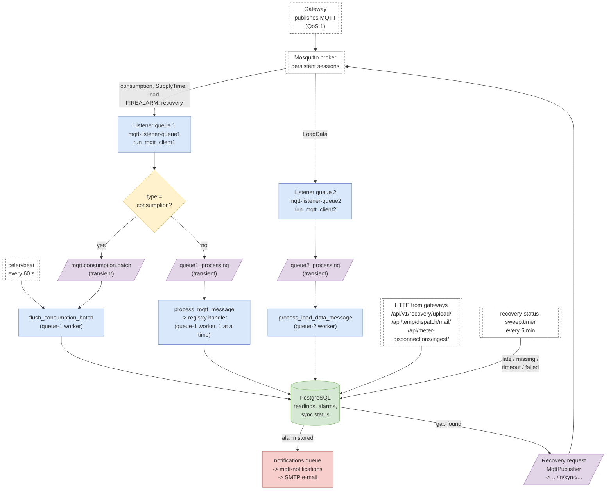

**Receiving.** `wareApp/tasks.py: mqtt_client1 / mqtt_client2` run the two listeners
(`consumers.run_mqtt_client1 / 2`) inside their own Celery workers. Each Paho
client connects with `clean_session=False` and QoS 1, so Mosquitto keeps the
packets while a listener restarts. The listener only parses the topic
(`MqttEnvelope.from_mqtt`) and queues the packet; it never touches the database.

**Queues.** Packet tasks are published transient (`delivery_mode=1`,
`MQTT_TRANSIENT_MESSAGES`): no disk write per packet; a RabbitMQ restart loses the
few packets in flight and recovery re-requests those hours. Consumption packets go
to `mqtt.consumption.batch` (flow 2); every other queue-1 type to
`queue1_processing` (or `mqtt.site.N` with `MQTT_SITE_PARTITIONS`); LoadData to
`queue2_processing`.

**Processing.** The queue-1 worker runs with concurrency 1, so packets of a site are
handled strictly in order, and the 60 s consumption flush never overlaps a
recovery reply. `process_mqtt_message -> _dispatch` finds the handler with
`registry.handler_for(type, subtype)`, skips duplicate consumption packets
(`services/idempotency`), loads the site (`services/site_cache.site`) and calls
`handler.handle(...)`, which returns an outcome text (`stored: …`, `skipped: …`,
`failed: …`) shown in the Celery log.

**Failure handling (all queue-1 handlers):** the task wrapper
`tasks._with_database_connection_cleanup` gives each packet a fresh DB connection
and retries transient database errors in place (`services/failures.run_with_db_retry`,
0.5 / 1 / 2 s), so the packet keeps its place in the site's order. Any other
error is stored as an `MqttDeadLetter` (`services/failures.record_dead_letter`)
and the handler returns `failed: …`; `manage.py replay_dead_letters` can process
it again.

| File | Function / role |
| --- | --- |
| `wareApp/mqtt/consumers.py` | run_mqtt_client1 / run_mqtt_client2, _queue_one_message_for_processing, _publish_options |
| `wareApp/mqtt/routing.py` | QUEUE_ONE/TWO subscriptions, processing_queue_for_site |
| `wareApp/mqtt/topics.py, envelope.py` | parse_gateway_topic, MqttEnvelope |
| `wareApp/mqtt/registry.py, handlers.py` | handler_for(type, subtype) -> handler class |
| `wareApp/tasks.py` | mqtt_client1/2, process_mqtt_message, _dispatch, flush_consumption_batch, process_load_data_message, send_notification |
| `warehouse/settings.py` | CELERY_BEAT_SCHEDULE, CELERY_TASK_QUEUES, MQTT_* settings |
| `deploy/systemd/*` | listener / processing / notifications units, sweep timer |

## 2. Consumption (live): batch every 60 s
<a id="consumption-live"></a>

Hourly and daily energy per aisle. Packets are parked for up to a minute and written in bulk with exactly the per-packet rules: current hour, new hour, first reading, gap -> recovery request.

Diagram to open and edit in draw.io: [`drawio/02-consumption-live.drawio`](drawio/02-consumption-live.drawio)

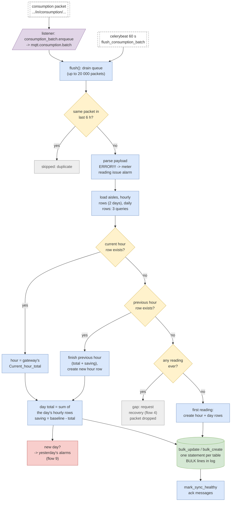

**Payload** (`consumption._parse_consumption_message`): consumption time, new units
since the last packet, hour, current-hour total, aisle group (leg) id and the
previous hour's final total. Warehouse-saving sites (`site_type 2`) treat values
over 10 000 as meter glitches (`_cap_warehouse_saving_values`).

**Rules per aisle, in arrival order** (`consumption_batch._apply`, identical to
`consumption.handle_consumption_message`):

1. *Current hour row exists:* set its consumption to the gateway's running total
   for that hour.
2. *New hour (previous hour exists):* set the previous hour to its final total,
   compute its saving (`hourly baseline - consumption`, active aisles only),
   create the new hour row with its baseline.
3. *First reading ever:* create the hour row and today's daily row.
4. *Gap* (neither current nor previous hour, but older data exists): request
   recovery from the gateway (flow 4, once per 10-minute cooldown) and drop the
   packet; live packets keep being dropped until the gap is filled.
5. *Daily row:* consumption = sum of the day's hourly rows, saving = daily
   baseline - total. Creating today's row evaluates yesterday's alarms (flow 9).
6. *Sensor aisles* (`on_sensor_power`) also get a `SensorAisleUnitConsumption` row.

**Writing.** All changes are written in one transaction, one `bulk_update` /
`bulk_create` per table (`_bulk` logs `BULK UPDATE HourlySiteReading (consumption
batch): rows=… aisles=… duration=… ms`). New rows get the same cleaning the
models' `save()` applies (`CleanReadingMixin`: NaN/negative -> 0, > 10 000 -> 0).
RabbitMQ messages are acknowledged only after the commit; on an error they are
re-queued for the next flush. `ERROR!!!` packets raise the Meter Reading Issue
alarm (flow 9). Summary line: `consumption batch: N packets, stored=… skipped=…
failed=… aisles=… in … ms`.

| File | Function / role |
| --- | --- |
| `wareApp/mqtt/consumption_batch.py` | enqueue, flush, process_consumption_batch, _parse, _load_states, _apply, _day_total, _as_saved, _bulk |
| `wareApp/mqtt/consumption.py` | per-packet rules (MQTT_CONSUMPTION_BATCH_SECONDS=0): handle_consumption_message, _parse_consumption_message, _notify_meter_reading_issue, _consumption_recovery_request |
| `wareApp/mqtt/services/idempotency.py` | claim / release (6 h duplicate check) |
| `wareApp/mqtt/services/baseline.py` | BaselineMemo, baseline_info, hourly_baseline |
| `wareApp/mqtt/sync_status.py` | mark_sync_healthy |
| `wareApp/tasks.py` | flush_consumption_batch |
| `Tables` | HourlySiteReading, DailySiteReading, SensorAisleUnitConsumption, AisleSyncRecoveryStatus |

## 3. SupplyTime: run time per power source
<a id="supply-time"></a>

Minutes each power source (mains, DG) ran in the hour. Same gap logic as consumption, per power source, using the loadRuntime recovery.

Diagram to open and edit in draw.io: [`drawio/03-supply-time.drawio`](drawio/03-supply-time.drawio)

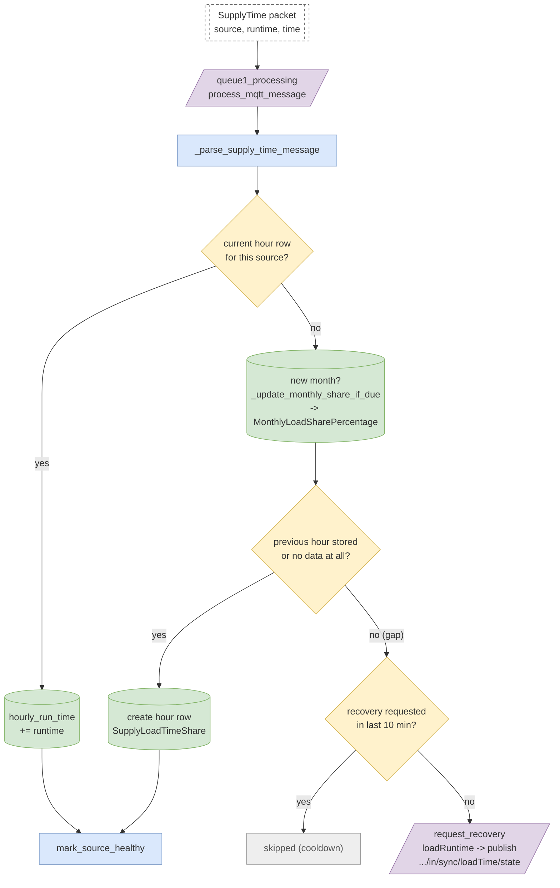

- **Current hour exists:** add the packet's run time to `hourly_run_time` (one UPDATE).
- **New hour:** at a month change first store last month's time share per source
  (`_update_monthly_share_if_due`). Then, if the previous hour is stored (or this
  source has no data yet), create the hour row.
- **Gap:** like consumption, but per power source: one recovery request per 10 min
  (`recovery_request_allowed(site, "source", source)`), recorded in
  `RecoveryMonitor` / `AisleSyncRecoveryStatus` (power_source rows) and published
  to `.../in/sync/loadTime/state` with the last stored hour and the missed seconds.
  The gateway answers on `recovery/loadRuntime` (flow 6).

**Failure handling (all queue-1 handlers):** the task wrapper
`tasks._with_database_connection_cleanup` gives each packet a fresh DB connection
and retries transient database errors in place (`services/failures.run_with_db_retry`,
0.5 / 1 / 2 s), so the packet keeps its place in the site's order. Any other
error is stored as an `MqttDeadLetter` (`services/failures.record_dead_letter`)
and the handler returns `failed: …`; `manage.py replay_dead_letters` can process
it again.

| File | Function / role |
| --- | --- |
| `wareApp/mqtt/supply_time.py` | handle_supply_time_message, _parse_supply_time_message, _previous_hour_exists, _update_monthly_share_if_due |
| `wareApp/mqtt/services/cooldown.py` | recovery_request_allowed (scope 'source') |
| `wareApp/mqtt/services/recovery_status.py` | RecoveryStatusService.request_recovery (LOAD_RUNTIME) |
| `wareApp/mqtt/sync_status.py` | mark_source_healthy |
| `Tables` | SupplyLoadTimeShare, MonthlyLoadSharePercentage, AisleSyncRecoveryStatus, RecoveryMonitor |

## 4. Recovery request lifecycle (sync requests)
<a id="recovery-lifecycle"></a>

What happens after a gap is found: the request, retries, failure and the per-aisle sync status, until the gateway's reply fills the gap.

Diagram to open and edit in draw.io: [`drawio/04-recovery-lifecycle.drawio`](drawio/04-recovery-lifecycle.drawio)

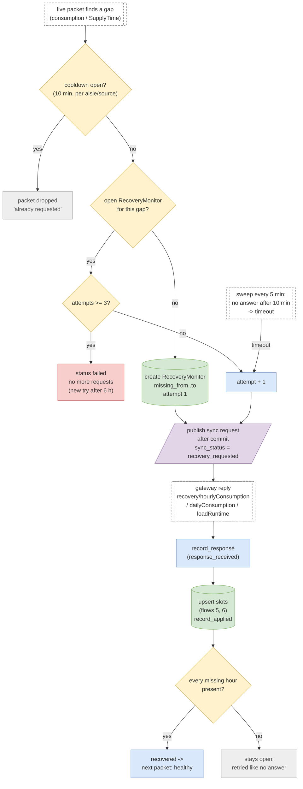

**States** (`AisleSyncRecoveryStatus.sync_status`, one row per aisle or power source):
`healthy -> recovery_requested -> recovery_received -> recovered -> healthy`;
no answer -> retried; 3 attempts (`MQTT_RECOVERY_MAX_ATTEMPTS`) -> `failed`;
a failed gap may start a fresh request after 6 h (`MQTT_RECOVERY_FAILED_RETRY_SECONDS`).
Independent of requests, the sweep marks an aisle `late` after 70 min and
`missing` after 130 min without a stored reading.

**Request** (`RecoveryStatusService.request_recovery`): records the missing range
in `RecoveryMonitor`, sets the status and decides whether to publish. Topics:
`.../in/sync/consumption/state` (consumption) and `.../in/sync/loadTime/state`
(SupplyTime). The publisher keeps one connected Paho client per worker process
and publishes only after the DB transaction commits.

**Reply:** the gateway answers on `recovery/<subtype>` (or via HTTP, flow 12).
`record_response` and `record_applied` mark what arrived; when every missing hour
is present the gap is `recovered` and the next live packet makes it `healthy`.
`ERROR404` values mean the gateway itself has no data: stored as 0, counted as
resolved, `has_data_loss` set; the first hour with data afterwards
(`catch_up_at`) carries the outage's consumption and is skipped by alarms.

**Manual retry:** admin -> Aisle sync recovery status -> "retry recovery" re-arms
failed requests (the next gap packet publishes again).

| File | Function / role |
| --- | --- |
| `wareApp/mqtt/services/recovery_status.py` | RecoveryScope, RecoveryStatusService.request_recovery / record_response / record_applied / _catch_up_slot |
| `wareApp/mqtt/services/cooldown.py` | recovery_request_allowed, release_recovery_request |
| `wareApp/mqtt/services/publisher.py` | MqttPublisher, publish_after_commit |
| `wareApp/mqtt/sync_status.py` | upsert_status, mark_sync_healthy, mark_source_healthy |
| `wareApp/management/commands/recovery_status_sweep.py` | sweep(): timeout / failed / late / missing |
| `wareApp/admin.py` | AisleSyncRecoveryStatusAdmin, retry recovery action |
| `Tables` | RecoveryMonitor (history), AisleSyncRecoveryStatus (current state) |

## 5. Consumption recovery replies (hourly and daily)
<a id="consumption-recovery"></a>

The gateway's answer to a consumption sync request: the missing hours (hourlyConsumption) or days (dailyConsumption) of one aisle, written in bulk.

Diagram to open and edit in draw.io: [`drawio/05-consumption-recovery.drawio`](drawio/05-consumption-recovery.drawio)

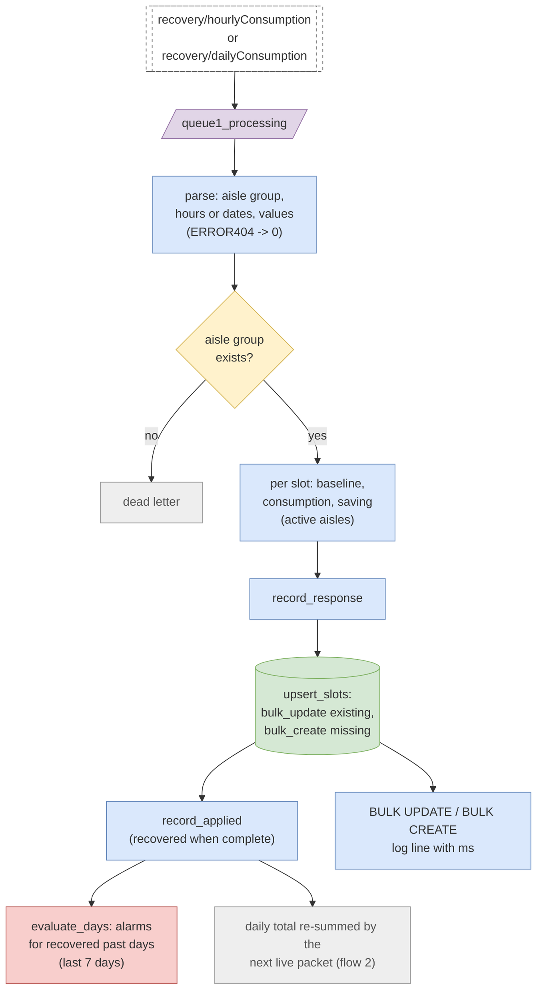

**Payloads:** hourly
`Aisle_group_id : <leg>; Recovery_Hours : [...]; Unit_consumptions : [...]; GW_total_cumulative : …`;
daily `Aisle_group_id : <leg>; Recovery_Dates : [...]; Unit_consumptions : [...]; GW_Total_cumulative : …`.

Each slot (hour or day) gets consumption, baseline (`BaselineMemo.for_day`) and
saving; `ERROR404` slots are stored as 0. Existing rows are updated and missing
ones created in bulk (`upsert_slots`), inside one transaction together with the
recovery status (`record_response` / `record_applied`). Afterwards
`evaluate_days` re-checks the day-end alarms of the recovered days (only the last
`ALARM_REEVALUATE_DAYS` = 7), and a single warning lists days whose baseline is
missing. The daily total of a day changed by an hourly recovery is set to the sum
of its hourly rows by the next live packet of that day.

**Failure handling (all queue-1 handlers):** the task wrapper
`tasks._with_database_connection_cleanup` gives each packet a fresh DB connection
and retries transient database errors in place (`services/failures.run_with_db_retry`,
0.5 / 1 / 2 s), so the packet keeps its place in the site's order. Any other
error is stored as an `MqttDeadLetter` (`services/failures.record_dead_letter`)
and the handler returns `failed: …`; `manage.py replay_dead_letters` can process
it again.

| File | Function / role |
| --- | --- |
| `wareApp/mqtt/hourly_consumption_recovery.py` | handle_hourly_consumption_recovery_message, _parse_hourly_recovery_message |
| `wareApp/mqtt/daily_consumption_recovery.py` | handle_daily_consumption_recovery_message, _parse_daily_recovery_message, _baseline_for_day |
| `wareApp/mqtt/slot_writes.py` | upsert_slots -> SlotWriteResult (updated, created, ms) |
| `wareApp/mqtt/log_format.py` | log_bulk_write, hour_ranges, day_ranges |
| `wareApp/mqtt/services/consumption_alarms.py` | evaluate_days |
| `Tables` | HourlySiteReading (hourly), DailySiteReading (daily), RecoveryMonitor, AisleSyncRecoveryStatus |

## 6. Load runtime recovery replies
<a id="load-runtime-recovery"></a>

The gateway's answer to a SupplyTime sync request: missing hourly run times of one power source.

Diagram to open and edit in draw.io: [`drawio/06-load-runtime-recovery.drawio`](drawio/06-load-runtime-recovery.drawio)

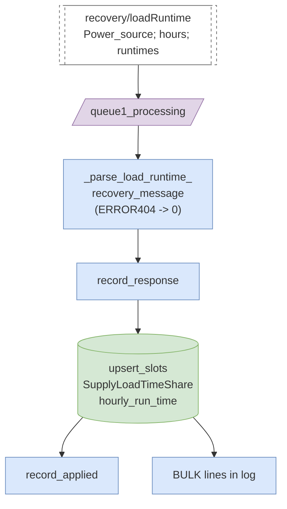

Payload `Power_source : <n>; Recovery_hours : [...]; Recovery_load_runtime : [...]`.
Each hour's run time is written to `SupplyLoadTimeShare` (update or create in
bulk); the recovery status of that power source moves to recovered when every
missing hour is present. No alarms are evaluated for run time.

**Failure handling (all queue-1 handlers):** the task wrapper
`tasks._with_database_connection_cleanup` gives each packet a fresh DB connection
and retries transient database errors in place (`services/failures.run_with_db_retry`,
0.5 / 1 / 2 s), so the packet keeps its place in the site's order. Any other
error is stored as an `MqttDeadLetter` (`services/failures.record_dead_letter`)
and the handler returns `failed: …`; `manage.py replay_dead_letters` can process
it again.

| File | Function / role |
| --- | --- |
| `wareApp/mqtt/load_runtime_recovery.py` | handle_load_runtime_recovery_message, _parse_load_runtime_recovery_message |
| `wareApp/mqtt/slot_writes.py` | upsert_slots |
| `wareApp/mqtt/services/recovery_status.py` | record_response, record_applied (LOAD_RUNTIME) |
| `Tables` | SupplyLoadTimeShare, RecoveryMonitor, AisleSyncRecoveryStatus |

## 7. Load: live load, voltage and power-factor alarms
<a id="load"></a>

Real-time load and phase values per meter and power source; updates the live table and raises high / low voltage and power-factor alarms.

Diagram to open and edit in draw.io: [`drawio/07-load.drawio`](drawio/07-load.drawio)

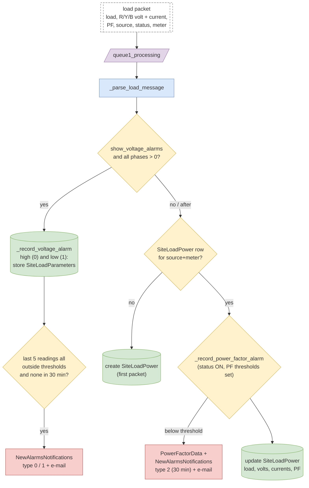

- **Voltage alarms** (only with `site.show_voltage_alarms` and all phases > 0): every
  packet is stored in `SiteLoadParameters` for high (0) and low (1); an alarm needs
  the last 5 readings all above the max (or below the min) thresholds and no alarm
  of that type and source in the last 30 minutes -> `NewAlarmsNotifications` + e-mail.
- **Power factor** (only with `site.is_pf_visible`, status ON and all three PF
  thresholds set; otherwise skipped and logged once an hour per site): any phase
  below its threshold stores `PowerFactorData`; at most one alarm per source per
  30 minutes -> `NewAlarmsNotifications` type 2 + e-mail.
- The live row `SiteLoadPower` (per site, source, meter) is created by the first
  packet and updated by every later one (load, volts, currents, PF, status).

**Failure handling (all queue-1 handlers):** the task wrapper
`tasks._with_database_connection_cleanup` gives each packet a fresh DB connection
and retries transient database errors in place (`services/failures.run_with_db_retry`,
0.5 / 1 / 2 s), so the packet keeps its place in the site's order. Any other
error is stored as an `MqttDeadLetter` (`services/failures.record_dead_letter`)
and the handler returns `failed: …`; `manage.py replay_dead_letters` can process
it again.

| File | Function / role |
| --- | --- |
| `wareApp/mqtt/load.py` | handle_load_message, _parse_load_message, _record_voltage_alarm, _record_power_factor_alarm |
| `wareApp/mqtt/services/notifications.py` | notify (send_alarm_for_high_voltage / low_voltage, send_mail_for_pf_fluctuation) |
| `wareApp/sendmail.py` | send_alarm_for_high_voltage, send_alarm_for_low_voltage, send_mail_for_pf_fluctuation |
| `Tables` | SiteLoadPower, SiteLoadParameters, PowerFactorData, NewAlarmsNotifications |
| `Site settings` | show_voltage_alarms, r/y/b_phase_voltage_threshold_max/min, is_pf_visible, r/y/b_phase_pf_threshold |

## 8. FIREALARM: fire pump state
<a id="fire-alarm"></a>

Fire-pump panel phases and motor status; mode changes and motor-on events are e-mailed to the customer.

Diagram to open and edit in draw.io: [`drawio/08-fire-alarm.drawio`](drawio/08-fire-alarm.drawio)

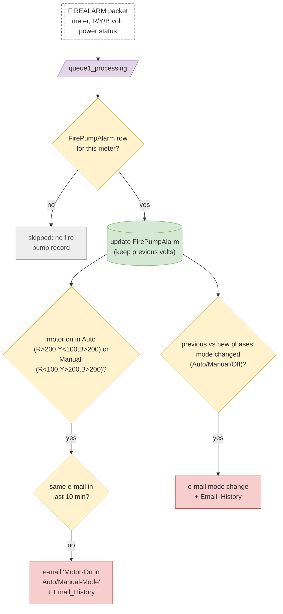

The phase pattern encodes the panel mode: R > 200, Y < 100, B > 200 = Auto;
R < 100, Y > 200, B > 200 = Manual. The handler keeps the previous voltages
before updating `FirePumpAlarm`, compares old and new pattern to detect a mode
change (e.g. Off-Mode to Auto-Mode) and e-mails the site's customer. "Motor on"
e-mails are limited to one per device per 10 minutes (`Email_History`,
`email_for=5`).

**Failure handling (all queue-1 handlers):** the task wrapper
`tasks._with_database_connection_cleanup` gives each packet a fresh DB connection
and retries transient database errors in place (`services/failures.run_with_db_retry`,
0.5 / 1 / 2 s), so the packet keeps its place in the site's order. Any other
error is stored as an `MqttDeadLetter` (`services/failures.record_dead_letter`)
and the handler returns `failed: …`; `manage.py replay_dead_letters` can process
it again.

| File | Function / role |
| --- | --- |
| `wareApp/mqtt/fire_alarm.py` | handle_fire_alarm_message, _parse_fire_alarm_message, _send_fire_alarm_email, _send_throttled_motor_on_email |
| `wareApp/sendmail.py` | send_mail_fire_alarm_user |
| `Tables` | FirePumpAlarm, Email_History |

## 9. Day-end consumption alarms (Bypassed / High / Low / Operation hours) and Meter Reading Issue
<a id="day-end-alarms"></a>

Each completed day of each aisle is compared with its own baseline. Bypassed is automatic at 100 %, High at 75 %, Low only where configured.

Diagram to open and edit in draw.io: [`drawio/09-day-end-alarms.drawio`](drawio/09-day-end-alarms.drawio)

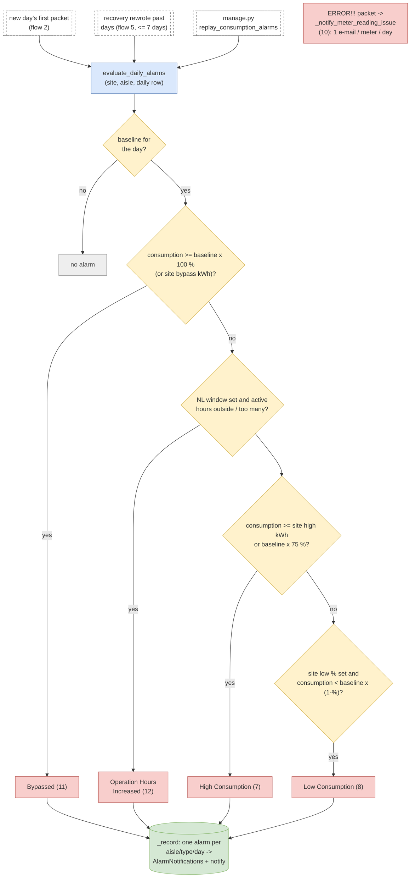

**When:** the first packet of a new day evaluates *yesterday* for that aisle; a
recovery that rewrote past days re-evaluates those days (last 7); the replay
command evaluates any period day by day.

**Order of checks** (`evaluate_daily_alarms`), per aisle and day, against the
aisle's own daily baseline (`SiteBaseline`; no baseline -> no alarm):
1. **Bypassed (11):** consumption >= baseline x `ALARM_BYPASS_DEFAULT_PERCENT` (100 %:
   no saving at all), or >= `site.bypass_consumption_units` when set. Stops here.
2. **Operation Hours Increased (12):** NL aisles of sites with an NL window: an
   hour with >= 0.01 kWh outside the window, or more active hours than allowed.
3. **High Consumption (7):** >= `site.high_consumption_units`, else >= baseline x
   75 % (`high_consumption_baseline_percent` / `ALARM_HIGH_CONSUMPTION_DEFAULT_PERCENT`).
   Names Operation Hours as the cause when both fire.
4. **Low Consumption (8):** only where `site.min_threshold_value` is set:
   consumption < baseline x (1 - value %).

**Stored** at most once per site, aisle, type and day (`_record`), with the reason
in `to_do`, then e-mailed (flow 10). **Meter Reading Issue (10)** comes from live
`ERROR!!!` consumption packets: the first per meter and day is stored and
e-mailed; repeats only update `last_seen` / `occurrences`.

| File | Function / role |
| --- | --- |
| `wareApp/mqtt/services/consumption_alarms.py` | evaluate_daily_alarms, evaluate_days, _bypass_threshold, _high_percent, operation_hours_check, _record |
| `wareApp/mqtt/consumption.py` | _consumption_alarms, _notify_meter_reading_issue |
| `wareApp/mqtt/consumption_batch.py` | alarm_days -> yesterday's alarms after the bulk write |
| `wareApp/management/commands/replay_consumption_alarms.py` | day-by-day replay (dry run / --apply / --email-site) |
| `wareApp/mqtt/services/baseline.py` | baseline_info |
| `Site settings` | bypass_consumption_units, high_consumption_units, high_consumption_baseline_percent, min_threshold_value, nl_operation_hours/start/end |
| `Settings` | ALARM_BYPASS_DEFAULT_PERCENT=100, ALARM_HIGH_CONSUMPTION_DEFAULT_PERCENT=75, ALARM_ACTIVITY_THRESHOLD_KWH, ALARM_REEVALUATE_DAYS |
| `Tables` | AlarmNotifications (Alarm_type 7, 8, 10, 11, 12) |

## 10. Alarm e-mail pipeline
<a id="alarm-email"></a>

Every alarm e-mail goes through the notifications queue to its own worker, so a slow mail server never blocks MQTT processing.

Diagram to open and edit in draw.io: [`drawio/10-alarm-email.drawio`](drawio/10-alarm-email.drawio)

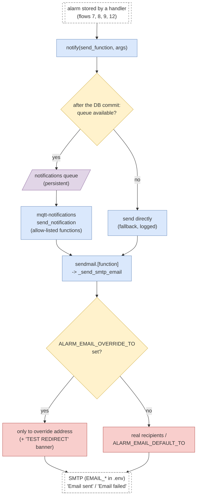

`notify()` queues the e-mail after the alarm's transaction commits (an alarm that
is rolled back never e-mails). If RabbitMQ is unavailable, the e-mail is sent
directly instead (`Notification queue unavailable … sending directly`). The
worker accepts only allow-listed function names. `_send_smtp_email` uses the
`EMAIL_*` settings from `.env`; while `ALARM_EMAIL_OVERRIDE_TO` is set (test),
every alarm goes only to that address with the intended recipients shown in a
banner. Each send logs `Email sent: subject=… to=…` or `Email failed: … error=…`.
A failed send (SMTP refused) is not retried today.

| File | Function / role |
| --- | --- |
| `wareApp/mqtt/services/notifications.py` | notify, ALLOWED_NOTIFICATIONS, QUEUE_ERRORS fallback |
| `wareApp/tasks.py` | send_notification (retries 5x on exceptions) |
| `wareApp/sendmail.py` | _send_smtp_email, _smtp_config, send_alarm_email, send_alarm_for_high/low_voltage, send_mail_for_pf_fluctuation, send_mail_fire_alarm_user |
| `Settings` | MQTT_ASYNC_NOTIFICATIONS, ALARM_EMAIL_OVERRIDE_TO, ALARM_EMAIL_DEFAULT_TO, EMAIL_HOST / PORT / USE_TLS / HOST_USER / HOST_PASSWORD |

## 11. LoadData (queue 2): load graph data
<a id="loaddata"></a>

Second-level load readings for the load graphs: raw rows, monthly min/max and minute / hour roll-ups. Failures become replayable dead letters.

Diagram to open and edit in draw.io: [`drawio/11-loaddata.drawio`](drawio/11-loaddata.drawio)

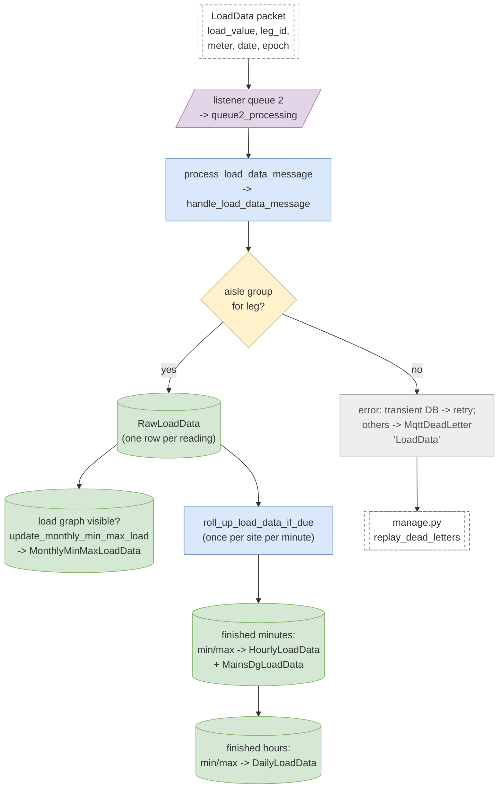

Each reading is stored raw (`RawLoadData`). If the site shows the load graph,
the month's minimum / maximum per source is kept in `MonthlyMinMaxLoadData`.
Once per site per minute, `roll_up_load_data_if_due` turns the finished minutes
(looking back `LOAD_DATA_ROLLUP_LOOKBACK_MINUTES`, 6 h) into min/max rows in
`HourlyLoadData` and `MainsDgLoadData`, and once per hour the finished hours into
`DailyLoadData`; buckets that already exist are skipped, so the roll-up is
idempotent (bulk inserts, logged as BULK CREATE).

Errors: transient database errors are re-raised so the task retries; every other
failure is stored as an `MqttDeadLetter` "LoadData" (configuration / payload errors
once per gateway per 10 min, unexpected errors every packet) and can be replayed
with `manage.py replay_dead_letters --type LoadData --apply`.

| File | Function / role |
| --- | --- |
| `wareApp/mqtt/consumers.py` | run_mqtt_client2 |
| `wareApp/tasks.py` | process_load_data_message |
| `wareApp/load_data/handler.py` | handle_load_data_message (outcome text, dead letters) |
| `wareApp/load_data/parser.py` | parse_load_data_message -> LoadReading |
| `wareApp/load_data/raw.py, monthly.py` | save_raw_load_reading, update_monthly_min_max_load |
| `wareApp/load_data/rollups.py` | roll_up_load_data_if_due, roll_up_completed_load_data, _save_batched_extrema |
| `wareApp/management/commands/replay_dead_letters.py` | replay failed packets (dry run / --apply) |
| `Tables` | RawLoadData, MonthlyMinMaxLoadData, HourlyLoadData, MainsDgLoadData, DailyLoadData, MqttDeadLetter |

## 12. HTTP calls from gateways
<a id="http-from-gateways"></a>

Three things gateways send over HTTP instead of MQTT: bulk recovery uploads, overheat alerts and meter-disconnection events.

Diagram to open and edit in draw.io: [`drawio/12-http-from-gateways.drawio`](drawio/12-http-from-gateways.drawio)

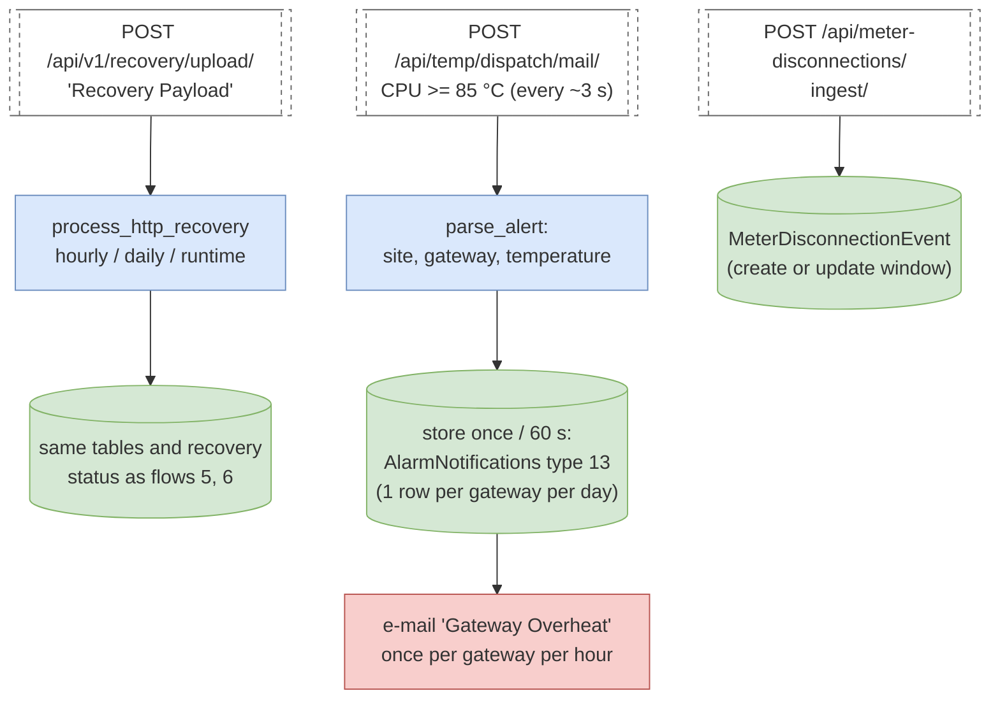

- **Recovery upload:** large recoveries can come over HTTP; the payload carries the
  original topic, site, gateway and data, and is processed with the same rules and
  recovery status as the MQTT replies.
- **Gateway overheat:** the gateway's temperature monitor posts while the CPU is at
  or above 85 °C. One alarm row per site, gateway and day (repeats update
  `last_seen` / `occurrences`), stored at most once a minute, e-mailed at most once
  an hour (`GATEWAY_OVERHEAT_STORE_SECONDS`, `GATEWAY_OVERHEAT_EMAIL_SECONDS`). Shown in
  the alarm list as a gateway alarm.
- **Meter disconnections:** the gateway's log watcher reports a disconnected meter
  with its detection window; stored as `MeterDisconnectionEvent` (no alarm or e-mail yet).

| File | Function / role |
| --- | --- |
| `wareApp/recovery/views.py, urls.py` | RecoveryUploadAPIView (/api/v1/recovery/upload/) |
| `wareApp/recovery/processor.py, service.py` | process_http_recovery, process_hourly, process_runtime, update_daily_from_hourly |
| `wareApp/views/gateway_overheat.py` | GatewayOverheatAlertApi (throttle gateway_overheat 60/min) |
| `wareApp/gateway_overheat.py` | parse_alert, record_overheat |
| `wareApp/views/monitoring.py` | MeterDisconnectionIngestView |
| `Tables` | HourlySiteReading, DailySiteReading, SupplyLoadTimeShare, AlarmNotifications, MeterDisconnectionEvent |

## 13. Timers, sweeps and maintenance commands
<a id="timers-and-checks"></a>

Everything that runs on a schedule or by hand around the MQTT pipeline.

Diagram to open and edit in draw.io: [`drawio/13-timers-and-checks.drawio`](drawio/13-timers-and-checks.drawio)

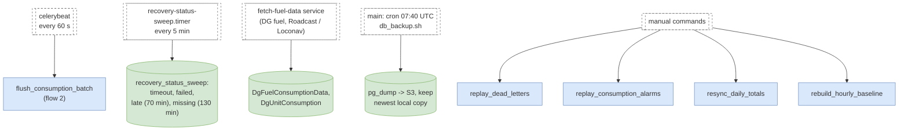

All manual commands are dry runs unless given `--apply`:

| Command | Use |
| --- | --- |
| `replay_dead_letters --type LoadData --since … --apply` | re-process packets that failed (LoadData and recovery replies any time; consumption / load / SupplyTime / FIREALARM only with `--allow-ordered-types`) |
| `replay_consumption_alarms --from … --to … [--email-site N] --apply` | day-end alarms for a past period; e-mails only for the given sites |
| `resync_daily_totals --from … --to … [--site N] --apply` | set daily rows to the sum of their hourly rows (skips days with missing hours or meter glitches) |
| `rebuild_hourly_baseline --from … --to … [--site N] --apply` | recompute hourly baseline and saving |

| File | Function / role |
| --- | --- |
| `warehouse/settings.py` | CELERY_BEAT_SCHEDULE (flush-consumption-batch) |
| `wareApp/management/commands/recovery_status_sweep.py` | sweep() |
| `fetch_fuel_data.py, wareApp/fuel_providers.py` | DG fuel pull (credentials from .env) |
| `deploy/main/db_backup.sh` | daily backup on main |
| `wareApp/management/commands/replay_dead_letters.py` | process stored failed packets again |
| `wareApp/management/commands/replay_consumption_alarms.py` | day-end alarms for a past period |
| `wareApp/management/commands/resync_daily_totals.py` | daily total = sum of hourly rows (skips incomplete / glitch days) |
| `wareApp/management/commands/rebuild_hourly_baseline.py` | recompute hourly baseline and saving |

## 14. High / Low Consumption and Bypassed alarms (detail)
<a id="high-low-bypassed"></a>

One completed day of one aisle is compared with that aisle's own daily baseline. Bypassed >= 100 %, High >= 75 %, Low below a site-set %. Example: UCB-F2, baseline 127.16 kWh: 121.5 kWh -> High, 202.3 kWh -> Bypassed.

Diagram to open and edit in draw.io: [`drawio/14-high-low-bypassed.drawio`](drawio/14-high-low-bypassed.drawio)

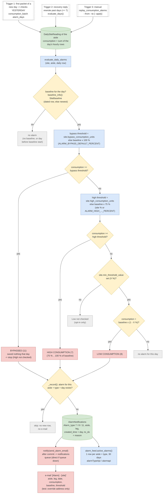

Focused version of flow 9 for the three consumption-level alarms (Operation Hours
Increased is checked between Bypassed and High; see flow 9).

| Alarm | Fires when (per aisle, per day) | Setting / override |
| --- | --- | --- |
| Bypassed (11) | consumption >= 100 % of the aisle's daily baseline | `ALARM_BYPASS_DEFAULT_PERCENT`; site `bypass_consumption_units` (kWh) |
| High Consumption (7) | consumption >= 75 % of baseline (and below the Bypassed level) | `ALARM_HIGH_CONSUMPTION_DEFAULT_PERCENT`; site `high_consumption_baseline_percent` or `high_consumption_units` (kWh) |
| Low Consumption (8) | consumption < baseline x (1 - X %) | only when site `min_threshold_value` = X is set |

Worked example - Farrukhnagar UCB-F2, daily baseline 127.16 kWh: Oct 3 121.52 kWh
(96 %) -> High (threshold 95.37); Oct 15 202.27 kWh (159 %) -> Bypassed (threshold
127.16); a normal day of ~44 kWh (35 %) -> no alarm. Each alarm is stored once per
aisle, type and day and e-mailed once; the alarm list shows one row per aisle and
type with first / last day and count.

| File | Function / role |
| --- | --- |
| `wareApp/mqtt/services/consumption_alarms.py` | evaluate_daily_alarms, evaluate_days, _bypass_threshold, _high_percent, _record (+ operation_hours_check, see flow 9) |
| `wareApp/mqtt/services/baseline.py` | baseline_info, BaselineMemo |
| `wareApp/mqtt/consumption_batch.py` | alarm_days -> yesterday after the bulk write |
| `wareApp/mqtt/hourly / daily_consumption_recovery.py` | evaluate_days after a recovery |
| `wareApp/management/commands/replay_consumption_alarms.py` | manual day-by-day replay |
| `wareApp/mqtt/services/notifications.py, sendmail.py` | notify, send_alarm_email |
| `wareApp/alarm_feed.py` | active_alarms (alarm list APIs) |
| `Settings` | ALARM_BYPASS_DEFAULT_PERCENT=100, ALARM_HIGH_CONSUMPTION_DEFAULT_PERCENT=75, ALARM_REEVALUATE_DAYS=7, ALARM_EMAIL_OVERRIDE_TO |
| `Site fields (overrides)` | bypass_consumption_units, high_consumption_units, high_consumption_baseline_percent, min_threshold_value |
| `Models` | Site, SiteBaseline, AisleGroup, DailySiteReading, AlarmNotifications |

## 15. Alarm catalogue: every alarm type and where it comes from
<a id="alarm-catalogue"></a>

Two alarm tables. AlarmNotifications: per aisle / meter / gateway. NewAlarmsNotifications: per site and power source. Each type below has its own detailed flow (14, 16-22).

Diagram to open and edit in draw.io: [`drawio/15-alarm-catalogue.drawio`](drawio/15-alarm-catalogue.drawio)

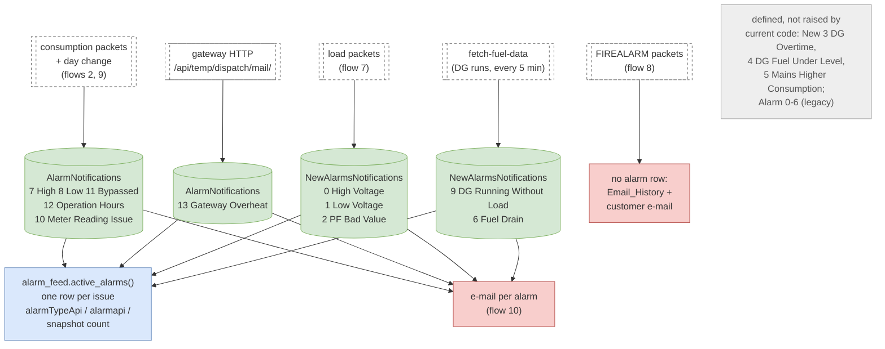

| Table | Type | Alarm | Raised by | Repeats | E-mail | Flow |
| --- | --- | --- | --- | --- | --- | --- |
| AlarmNotifications | 7 | High Consumption | day-end check, per aisle | 1 per aisle / day | yes | 14 |
| AlarmNotifications | 8 | Low Consumption | day-end check (site opt-in) | 1 per aisle / day | yes | 14 |
| AlarmNotifications | 11 | Bypassed | day-end check, per aisle | 1 per aisle / day | yes | 14 |
| AlarmNotifications | 12 | Operation Hours Increased | day-end check, NL aisles with NL window | 1 per aisle / day | yes | 16 |
| AlarmNotifications | 10 | Meter Reading Issue | live `ERROR!!!` consumption packet | 1 per meter / day (+ count) | first of the day | 17 |
| AlarmNotifications | 13 | Gateway Overheat | gateway HTTP alert (CPU >= 85 °C) | 1 per gateway / day (+ count) | max 1 / hour | 18 |
| NewAlarmsNotifications | 0 / 1 | High / Low Voltage | live load packets | max 1 per source / 30 min | yes | 19 |
| NewAlarmsNotifications | 2 | PF Bad Value | live load packets | max 1 per source / 30 min | yes | 20 |
| NewAlarmsNotifications | 9 | DG Running Without Load | fuel fetch after a DG run | 1 per DG unit fetch | yes | 21 |
| NewAlarmsNotifications | 6 | Fuel Drain | fuel fetch after a DG run | 1 per DG unit fetch | yes | 21 |
| (none) | - | Fire pump mode / motor on | FIREALARM packets | motor-on max 1 / 10 min | yes (customer) | 22 |

Types defined in the models but **not raised by the current code**: NewAlarms 3 DG
Overtime, 4 DG Fuel Under Level, 5 Mains Higher Consumption (only the old root
`tasks.py` raised 3; the e-mail functions still exist in `sendmail.py`), and
AlarmNotifications 0-6 (Low balance, Power cut, ... Internet gone: legacy).
Priority labels in the alarm list: 0 High, 1 Medium, 2 Low.

| File | Function / role |
| --- | --- |
| `wareApp/models.py` | AlarmNotifications (Alarm_type), NewAlarmsNotifications (alarm_type) |
| `wareApp/mqtt/services/consumption_alarms.py` | 7, 8, 11, 12 |
| `wareApp/mqtt/consumption.py` | 10 Meter Reading Issue |
| `wareApp/gateway_overheat.py` | 13 Gateway Overheat |
| `wareApp/mqtt/load.py` | 0, 1 voltage; 2 power factor |
| `wareApp/dg_fuel/sessions.py` | 9 DG Running Without Load, 6 Fuel Drain |
| `wareApp/mqtt/fire_alarm.py` | fire pump e-mails (no alarm row) |
| `wareApp/alarm_feed.py` | active_alarms, PRIORITY_LABELS, CONSUMPTION_TYPES, POWER_TYPES |

## 16. Operation Hours Increased (Alarm type 12)
<a id="operation-hours"></a>

NL (normal lighting) aisles must only draw power inside the site's NL window; checked per aisle at the day end, between the Bypassed and High checks.

Diagram to open and edit in draw.io: [`drawio/16-operation-hours.drawio`](drawio/16-operation-hours.drawio)

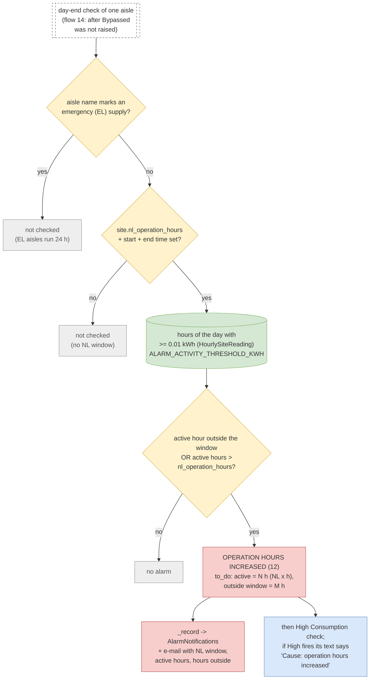

An hour counts as *active* when its consumption is at least 0.01 kWh. The NL window
may cross midnight (`_in_window`). The alarm fires when any active hour lies outside
the window, or there are more active hours than `nl_operation_hours`. Stored once per
aisle and day like the other day-end alarms; a High Consumption alarm on the same
day names it as the cause. **No site has an NL window configured today**, so this
alarm cannot fire until `nl_operation_hours` and the start / end times are set.

| File | Function / role |
| --- | --- |
| `wareApp/mqtt/services/consumption_alarms.py` | operation_hours_check, _in_window, _activity_threshold, evaluate_daily_alarms, _record |
| `wareApp/mqtt/services/baseline.py` | is_emergency_supply (EL aisle names) |
| `Site fields` | nl_operation_hours, nl_operation_start_time, nl_operation_end_time |
| `Settings` | ALARM_ACTIVITY_THRESHOLD_KWH = 0.01 |
| `Models` | HourlySiteReading, AlarmNotifications |

## 17. Meter Reading Issue (Alarm type 10)
<a id="meter-reading-issue"></a>

The gateway reports that a meter's new cumulative reading is smaller than the previous one (meter reset / fault). Raised live, per meter, once per day.

Diagram to open and edit in draw.io: [`drawio/17-meter-reading-issue.drawio`](drawio/17-meter-reading-issue.drawio)

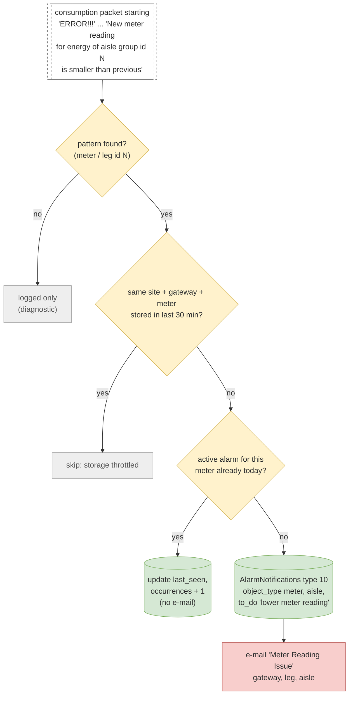

`ERROR!!!` packets carry no reading, so nothing is stored in the reading tables. The
meter (= leg / aisle group id) is taken from the text. At most one write per site,
gateway and meter every 30 minutes (cache); within a day the existing alarm is only
updated (`last_seen`, `occurrences`), so the alarm list shows e.g. "occurrences: 84"
while the e-mail went out once that day.

| File | Function / role |
| --- | --- |
| `wareApp/mqtt/consumption_batch.py` | _parse: ERROR!!! packets go here instead of the readings |
| `wareApp/mqtt/consumption.py` | _notify_meter_reading_issue, METER_READING_ISSUE_PATTERN, METER_READING_ISSUE_COOLDOWN_SECONDS = 1800 |
| `Models` | AlarmNotifications (last_seen, occurrences), AisleGroup |

## 18. Gateway Overheat (Alarm type 13)
<a id="gateway-overheat"></a>

The gateway's temperature monitor posts over HTTP every ~3 s while its CPU is at or above 85 °C.

Diagram to open and edit in draw.io: [`drawio/18-gateway-overheat.drawio`](drawio/18-gateway-overheat.drawio)

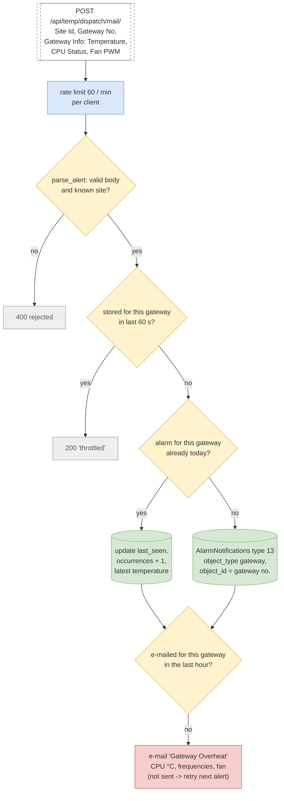

One alarm row per site, gateway and day; repeats inside the day update the same row.
The e-mail goes out at most once per gateway per hour while the gateway stays hot;
if it could not be sent, the hourly mark is released so the next alert retries.
The response tells the gateway `stored`, `repeated`, `throttled` or `rejected`.

| File | Function / role |
| --- | --- |
| `wareApp/views/gateway_overheat.py` | GatewayOverheatAlertApi, GatewayOverheatThrottle |
| `wareApp/gateway_overheat.py` | parse_alert, record_overheat, GATEWAY_OVERHEAT_ALARM_TYPE |
| `wareApp/alarm_feed.py` | shown as source 'gateway' with the matching home gateway id |
| `Settings` | GATEWAY_OVERHEAT_STORE_SECONDS = 60, GATEWAY_OVERHEAT_EMAIL_SECONDS = 3600 |
| `Gateway side` | recovery_gateway_live/temperature.py (posts while >= 85 °C) |

## 19. High / Low Voltage (NewAlarms type 0 / 1)
<a id="voltage"></a>

From live load packets: every reading is kept; an alarm needs five consecutive readings outside the site's phase thresholds.

Diagram to open and edit in draw.io: [`drawio/19-voltage.drawio`](drawio/19-voltage.drawio)

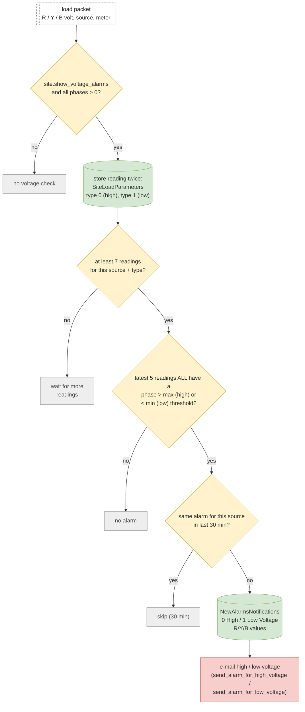

Each load packet stores its phase voltages twice in `SiteLoadParameters` (type 0 for
the high check, type 1 for the low check). Once at least seven readings exist, the
latest five are checked: **all five** must have at least one phase above the site's
max (high) or below its min (low). At most one alarm per site, source and type per
30 minutes, each e-mailed. Sites with `show_voltage_alarms` off are never checked.

| File | Function / role |
| --- | --- |
| `wareApp/mqtt/load.py` | handle_load_message, _record_voltage_alarm, _voltage_alarm_data |
| `wareApp/sendmail.py` | send_alarm_for_high_voltage, send_alarm_for_low_voltage |
| `Site fields` | show_voltage_alarms, r/y/b_phase_voltage_threshold_max, r/y/b_phase_voltage_threshold_min |
| `Models` | SiteLoadParameters, NewAlarmsNotifications |

## 20. PF Bad Value (NewAlarms type 2)
<a id="power-factor"></a>

From live load packets with power factors: any phase below the site's PF threshold while the source is ON.

Diagram to open and edit in draw.io: [`drawio/20-power-factor.drawio`](drawio/20-power-factor.drawio)

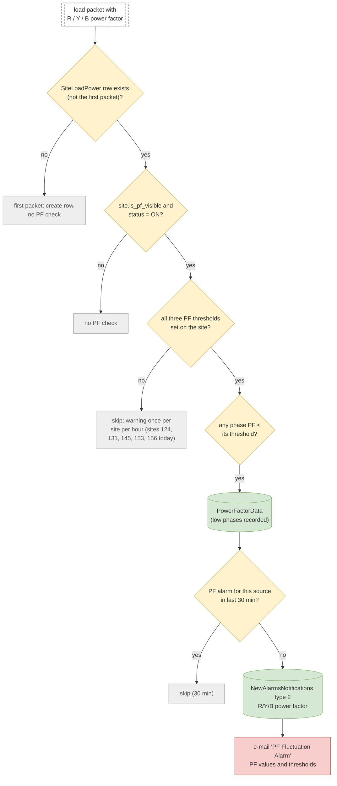

Checked on every load packet after the first one for that source and meter. Missing
PF thresholds skip the check entirely (one warning per site per hour) - those sites
never raise PF alarms. Low phases are recorded in `PowerFactorData` on every packet;
the alarm itself is limited to one per site and source per 30 minutes, each e-mailed.

| File | Function / role |
| --- | --- |
| `wareApp/mqtt/load.py` | _record_power_factor_alarm (called from handle_load_message) |
| `wareApp/sendmail.py` | send_mail_for_pf_fluctuation |
| `Site fields` | is_pf_visible, r_phase_pf_threshold, y_phase_pf_threshold, b_phase_pf_threshold |
| `Models` | PowerFactorData, NewAlarmsNotifications, SiteLoadPower |

## 21. DG alarms: Running Without Load (9) and Fuel Drain (6)
<a id="dg-alarms"></a>

Raised by the fetch-fuel-data service after the fuel used by a DG on a day is fetched from the fuel provider (Roadcast / Loconav).

Diagram to open and edit in draw.io: [`drawio/21-dg-alarms.drawio`](drawio/21-dg-alarms.drawio)

```mermaid
flowchart TD
    svc[["fetch-fuel-data service<br/>every 5 min"]]
    rec[("reconcile_daily_unit_consumption:<br/>DgUnitConsumption per DG aisle<br/>per day (energy from<br/>DailySiteReading)")]
    pend["units with<br/>fetch_fuel_data = True"]
    prov{"provider configured?<br/>(aisle / site: roadcast,<br/>loconav)"}
    noprov["skip"]
    fetch["fetch fuel used for the<br/>DG window (credentials<br/>from .env)"]
    ok{"usable fuel value?"}
    retry["keep fetch_fuel_data = True<br/>(retry next cycle)"]
    save[("save dg_fuel_consumption,<br/>fetch_fuel_data = False")]
    load{"DG energy (unit_consumption)<br/><= 0 kWh?"}
    r9["NewAlarms 9 DG RUNNING<br/>WITHOUT LOAD + e-mail"]
    drain{"fuel used > 1.2 x<br/>site.dg_fuel_tank_capacity?"}
    r6["DGFuelAlertsData 'suspicious_fuel'<br/>+ NewAlarms 6 FUEL DRAIN<br/>+ e-mail"]
    prov2[("provider refuel / theft<br/>events -> DGFuelAlertsData<br/>(stored, no e-mail)")]
    svc --> rec
    rec --> pend
    pend --> prov
    prov -->|"no"| noprov
    prov -->|"yes"| fetch
    fetch --> ok
    ok -->|"no"| retry
    ok -->|"yes"| save
    save --> load
    load -->|"yes"| r9
    save --> drain
    drain -->|"yes"| r6
    save --> prov2
    classDef decision fill:#fff2cc,stroke:#d6b656
    class prov,ok,load,drain decision
    classDef db fill:#d5e8d4,stroke:#82b366
    class rec,save,prov2 db
    classDef alarm fill:#f8cecc,stroke:#b85450
    class r9,r6 alarm
    classDef ext fill:#ffffff,stroke:#666,stroke-dasharray:4
    class svc ext
    classDef skip fill:#eee,stroke:#999,color:#555
    class noprov,retry skip
    classDef process fill:#dae8fc,stroke:#6c8ebf
    class pend,fetch process
```

For each DG aisle and day `reconcile_daily_unit_consumption` keeps a
`DgUnitConsumption` row with the DG's energy (from `DailySiteReading`). Rows still
needing fuel (`fetch_fuel_data = True`) are fetched from the configured provider;
without a usable value they are retried on the next cycle.

After a successful fetch:
- **DG Running Without Load (9):** the DG used fuel but its energy is <= 0 kWh.
- **Fuel Drain (6):** fuel used is more than 1.2 x the site's tank capacity
  (also stored as `DGFuelAlertsData` "suspicious_fuel").
- Refuel / theft events reported by the provider are stored in `DGFuelAlertsData`
  only (no alarm, no e-mail).

Both alarms are raised once per DG unit (the fetch flag is cleared afterwards) and
e-mailed. Type 9 is missing from the model's choices; the alarm list adds its name
(`alarm_feed.POWER_TYPES`).

| File | Function / role |
| --- | --- |
| `fetch_fuel_data.py` | run_dg_fuel_cycle (service loop, DG_FUEL_POLL_INTERVAL_SECONDS = 300) |
| `wareApp/dg_fuel/sessions.py` | reconcile_daily_unit_consumption, attempt_fetch_for_unit, determine_provider, _persist_provider_alerts |
| `wareApp/fuel_providers.py` | detect_suspicious_fuel (> 1.2 x tank), roadcast / loconav fetch |
| `wareApp/sendmail.py` | send_alarm_email |
| `Site / aisle fields` | dg_fuel_tank_capacity, dg_fuel_enabled, dg_fuel_provider, dg_fuel_vehicle_number |
| `Models` | DgUnitConsumption, DGFuelAlertsData, NewAlarmsNotifications |

## 22. Fire pump e-mails (FIREALARM, no alarm row)
<a id="fire-pump-emails"></a>

Panel mode changes and motor-on events, decoded from the three phase voltages; e-mailed to the site's customer and logged in Email_History.

Diagram to open and edit in draw.io: [`drawio/22-fire-pump-emails.drawio`](drawio/22-fire-pump-emails.drawio)

```mermaid
flowchart TD
    in[["FIREALARM packet<br/>meter, R / Y / B volt,<br/>power status"]]
    rec{"FirePumpAlarm row<br/>for this meter?"}
    skip["skipped"]
    keep[("keep previous volts,<br/>update FirePumpAlarm")]
    modes["mode from phases:<br/>Auto = R>200, Y<100, B>200<br/>Manual = R<100, Y>200, B>200<br/>Off = R<100, Y<100, B>200"]
    motor{"motor ON (power status 1)<br/>in Auto or Manual?"}
    ten{"motor-on e-mail for this<br/>device in last 10 min?"}
    m1["e-mail 'Motor-On in<br/>Auto / Manual-Mode'"]
    chg{"previous mode !=<br/>new mode?"}
    m2["e-mail mode change, e.g.<br/>'Auto-Mode to Manual-Mode',<br/>'Off-Mode to Auto-Mode'"]
    hist[("Email_History<br/>(device, email_for, time)")]
    in --> rec
    rec -->|"no"| skip
    rec -->|"yes"| keep
    keep --> modes
    keep --> motor
    motor -->|"yes"| ten
    ten -->|"no"| m1
    modes --> chg
    chg -->|"yes"| m2
    m1 --> hist
    m2 --> hist
    classDef decision fill:#fff2cc,stroke:#d6b656
    class rec,motor,ten,chg decision
    classDef db fill:#d5e8d4,stroke:#82b366
    class keep,hist db
    classDef alarm fill:#f8cecc,stroke:#b85450
    class m1,m2 alarm
    classDef ext fill:#ffffff,stroke:#666,stroke-dasharray:4
    class in ext
    classDef skip fill:#eee,stroke:#999,color:#555
    class skip skip
    classDef process fill:#dae8fc,stroke:#6c8ebf
    class modes process
```

No alarm row: these are e-mails to the site's customer (`site.customer.email`),
recorded in `Email_History` (`email_for`: 1 Auto->Manual, 2 ->Auto, 4 ->Off,
5 motor on, ...). The mode is read from which phases are above 200 V / below 100 V;
the handler compares the previous and the new pattern to name the change. Motor-on
e-mails are limited to one per device per 10 minutes. Being alarm e-mails, they also
go only to `ALARM_EMAIL_OVERRIDE_TO` while that is set (test).

| File | Function / role |
| --- | --- |
| `wareApp/mqtt/fire_alarm.py` | handle_fire_alarm_message, _send_fire_alarm_email, _send_throttled_motor_on_email |
| `wareApp/sendmail.py` | send_mail_fire_alarm_user |
| `Models` | FirePumpAlarm, Email_History |

